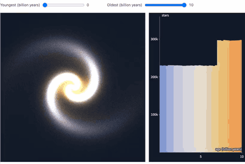
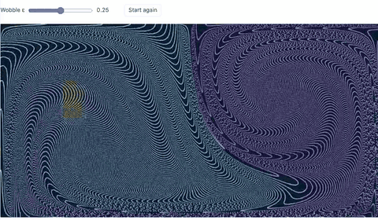
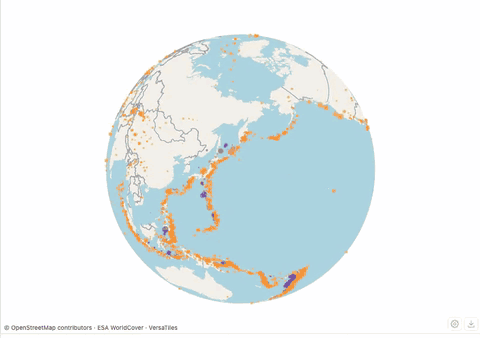

# HMPlot

[](https://github.com/gabehope/HMPlot/releases)
[](LICENSE)
[](https://gabehope.github.io/HMPlot/)

**Alpha:** HMPlot 0.1.0-alpha.1 is its first public release, and the API may still change. The
[documentation site](https://gabehope.github.io/HMPlot/) has the API reference and the examples;
the user guide is still being written.
<!-- The CI badge (.github/workflows/ci.yml) goes here once the repository is public (R3). -->

HMPlot draws interactive charts, maps and 3D scenes with WebGPU, from Svelte and from Python
notebooks. Data, transforms and rendering share one GPU device, so a plot of millions of points,
a histogram that follows a brush across them, and a map beside them stay live. Svelte and Python
build the same scenes from the same components: `Plot`, marks such as `Points`, `Line` and
`Heatmap`, transforms such as `Bin`, `Filter` and `Density`, inputs, facets, graphs and maps.

## Demos

Three of the gallery's examples, recorded in Chrome at a device pixel ratio of 2 (the full
recordings are MP4s in [static/media](static/media)):

**Ten million points, filtered live.** Ten million stars of a spiral galaxy, generated on the GPU
from a seed. The current example is an orbitable 3D view with temperature-based colors,
compressed luminosity and a linked, brushable H–R diagram. Two sliders filter both views by age.
The recording below shows the earlier 2D version with its age histogram.
([program](src/routes/examples/stress/TenMillionStars.svelte), [MP4](static/media/ten-million-stars.mp4))



**A running simulation.** 45,000 particles in a double gyre, a model of mixing in ocean flows,
stepped on the GPU at the display's rate. A Shift-drag box drops dye that the flow carries off in
thin filaments, and a slider changes how the eddies mix.
([Python](src/examples/double-gyre/double-gyre.py), [Svelte](src/examples/double-gyre/double-gyre.svelte),
[MP4](static/media/double-gyre.mp4))



**A globe with streamed map tiles.** OpenStreetMap vector tiles stream onto an orthographic globe
as it turns and zooms, from the Pacific down to Tokyo's streets, under every magnitude 4.5+
earthquake of 2024. ([Python](src/examples/globe-tiles/globe-tiles.py),
[Svelte](src/examples/globe-tiles/globe-tiles.svelte), [MP4](static/media/globe-tiles.mp4);
map data © OpenStreetMap contributors, ESA WorldCover, VersaTiles)



## Install

HMPlot is not on PyPI or npm yet: install it from the
[GitHub release](https://github.com/gabehope/HMPlot/releases/tag/v0.1.0-alpha.1).

```sh
# Python 3.11 or later, in your notebook kernel's environment
pip install https://github.com/gabehope/HMPlot/releases/download/v0.1.0-alpha.1/hmplot-0.1.0a1-py3-none-any.whl

# Svelte 5 (npm also installs the peer dependencies, three.js and Threlte)
npm install https://github.com/gabehope/HMPlot/releases/download/v0.1.0-alpha.1/hmplot-0.1.0-alpha.1.tgz
```

Interactive rendering requires WebGPU, in the browser or the notebook's webview.

## Python

```python
import hmplot as hm
import numpy as np

rng = np.random.default_rng(0)
x = rng.normal(size=100_000)
data = {"x": x, "y": 0.5 * x + rng.normal(size=100_000)}

with hm.Plot(data=data, axes2d=True) as plot:
    hm.Points(x="x", y="y", size=1, fill="y", brush=True)  # Shift-drag to brush

plot  # in a notebook; or hm.export_png(plot, "plot.png")
```

## Svelte

```svelte
<script>
  import { Plot, Points } from "hmplot";

  const x = Array.from({ length: 100_000 }, () => Math.random() * 4 - 2);
  const data = { x, y: x.map((v) => 0.5 * v + Math.random() - 0.5) };
</script>

<Plot {data} axes2d height={400}>
  <Points x="x" y="y" size={1} fill="y" brush /> <!-- Shift-drag to brush -->
</Plot>
```

## Checking a plot, and coding agents

- `hmplot check plot.py` runs a Python program as a notebook cell runs and draws its plot
  headlessly: it prints the errors (each naming the component and what to pass instead), each
  mark's row count and columns, the axes' ranges, and saves a PNG. `hm.check(plot)` does the same
  from Python ([python/README.md](python/README.md#checking-a-plot-without-a-notebook)).
- [skills/hmplot](skills/hmplot/SKILL.md) is an agent skill for HMPlot (when it fits, how a scene
  is built, tested patterns, common mistakes), packaged as a Claude Code plugin:
  `/plugin marketplace add hmplot/hmplot`, then `/plugin install hmplot@hmplot`.
- The docs site serves `llms.txt` (one line per page), `llms-full.txt` (every guide and reference
  page) and each page as Markdown, at its address plus `.md`.

## Requirements

- **A browser with WebGPU:** Chrome or Edge 113 or later on the desktop. Safari and Firefox are
  adding WebGPU; check their current support. There is no WebGL fallback; a notebook in a browser
  without WebGPU shows a static image of the plot, drawn by the kernel.
- **Python:** 3.11 or later. Exports (PNG, SVG, PDF, HTML, MP4) draw in a headless Chrome: an
  installed Chrome, Edge or Chromium, or Chrome for Testing, downloaded once
  ([docs/DOCUMENT-EXPORT.md](docs/DOCUMENT-EXPORT.md)).
- **Svelte:** Svelte 5 with Vite ([docs/USAGE.md](docs/USAGE.md)).

## Status

Experimental: version 0.x, so the API may still change, and every change is listed in
[CHANGELOG.md](CHANGELOG.md). [docs/STABILITY.md](docs/STABILITY.md) says what the public API is
and what is tested where.

## Documentation

Simulations can start with GPU-generated rows instead of an uploaded table:
`<Data rows={10000}>…</Data>` in Svelte, or `with hm.Data(rows=10000):` in Python.
Generate columns in Calculate with `row()`, constants and `random()` (`hm.row()` and
`hm.random()` in Python). See
[the simulation example](python/examples/82_constant_data.py).

- [Using the library in a Svelte app](docs/USAGE.md) and [the Python package](python/README.md)
- [Data, expressions and scales](docs/DATA.md), [facets](docs/FACETS.md),
  [inputs](docs/INPUTS.md), [animation](docs/ANIMATION.md), [maps](docs/SPHERICAL.md),
  [vector tiles](docs/VECTOR-TILES.md), [exports](docs/DOCUMENT-EXPORT.md)
- [Known limitations](docs/LIMITATIONS.md)
- The docs site, with a reference for every component and runnable examples: `npm run dev` in
  this repository, then open `/docs`.

## How this was built

A core written by hand with GitHub Copilot's completions and occasional help from a chat
assistant, then extended with Codex and Claude, reviewed and tested: see [TESTING.md](TESTING.md)
for the suites and what runs where.

## Contributing

[CONTRIBUTING.md](CONTRIBUTING.md) covers setup, the test commands and the contribution terms.
Please report security issues as [SECURITY.md](SECURITY.md) describes. Everyone taking part
follows the [code of conduct](CODE_OF_CONDUCT.md).

<!-- Support and sponsorship (R4.2). -->

## License

MIT: see [LICENSE](LICENSE). The code, fonts and data HMPlot bundles or redistributes keep their
own licenses: see [THIRD_PARTY_NOTICES.md](THIRD_PARTY_NOTICES.md).
