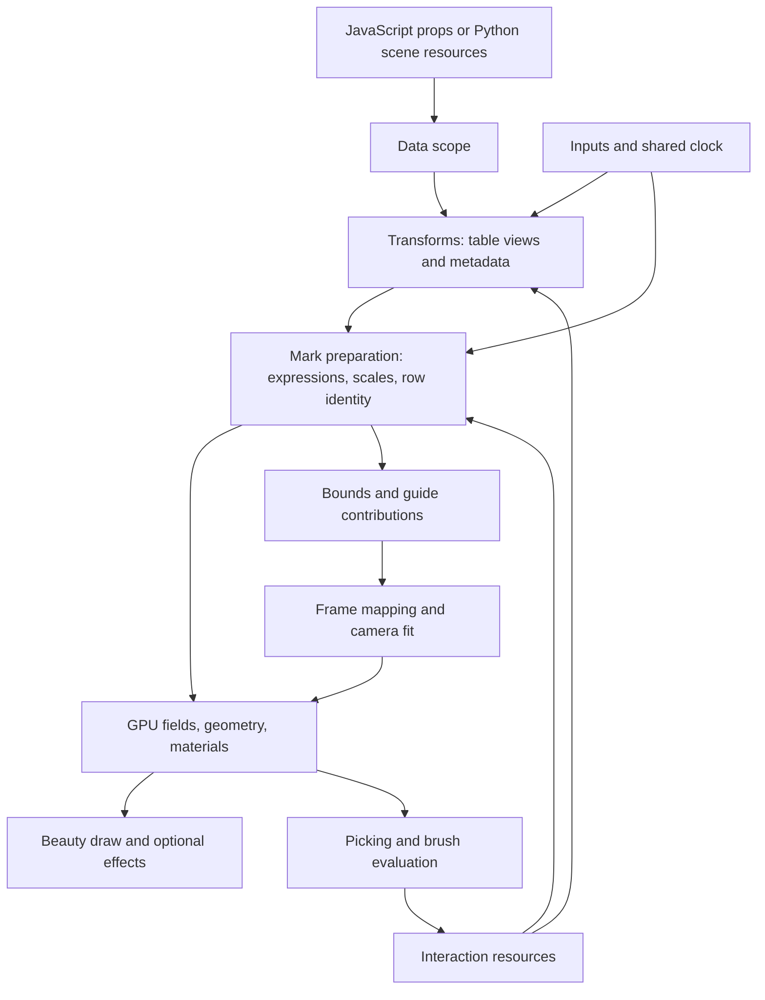

# HMPlot node execution reference

This is a source audit of HMPlot's execution model: what each node consumes, what it produces,
which implementation runs, what is retained, and what changes cause work. It covers public
and internal node families, expression nodes, and the shared execution machinery.
The original audit predates the chart/statistical namespaces and several API removals;
the generated reference is the complete current API catalog. JavaScript components and Python scene nodes use
the same browser implementations; names below use the JavaScript spelling.

**Original audit baseline:** `97f0e96a` on `main`, October 6, 2026. The tween and graph entries
were subsequently updated for Stages 100–102: producer-owned current columns, GraphData,
FromEdges and table-scoped node/edge transforms. Historical timing results retain their
original measurement scope.
The feature-boundary descriptions were retraced on 2026-10-17 against `321c8382`; see
[the core map and acceptance record](CORE.md). This source audit does not certify the pending
accumulated-stage rendering gate or production comparison. Numerical transform entries
include the Stage 138 plugin migrations; their acceptance is recorded separately in TODO.
It is an architectural audit, not a new timing experiment. Costs depend on data, nesting, GPU,
and enabled interactions. Source links identify the implementations behind the descriptions.

### Main findings

- The library has reusable scope, transform, field, mapping and interaction contracts, but
  does **not** optimize the whole scene as one numerical program.
- Several important fast paths depend on retained metadata: padded visibility, grid shape,
  source-row identity, aggregate provenance, live-column dependencies and graph topology.
- A warm shader cache removes compilation work, while recomputation, CPU preparation,
  allocation, copying and GPU waits can remain expensive.
- “GPU layout” describes one part of a pipeline. Automatic bounds, filtering, labels and
  picking can still synchronize around it.
- Most ordinary marks share preparation machinery. GeoJSON, live tiles, generic Surface,
  graph layouts and compound geometry have additional specialized paths.

## Node index

Find a component directly below. Private transforms and expressions have their own sections.

| Node | Node | Node | Node |
|---|---|---|---|
| — | [Anchor](#anchor) | [Area](#area) | [Arrows](#arrows) |
| [Arrows3D](#arrows3d) | [Bar](#bar) | [Bin](#bin) | [BoxPlot](#boxplot) |
| [Button](#button) | [Calculate](#calculate) | [Callout](#callout) | [Checkbox](#checkbox) |
| [ColorPicker](#colorpicker) | [Column](#column) | [Data](#data) | [Contour](#contour) |
| — | [Crosshair](#crosshair) | [DAG](#dag) | — |
| [DateTimeInput](#datetimeinput) | [Delaunay](#delaunay) | [Density](#density) | [DensityContour](#densitycontour) |
| — | [Dodge](#dodge) | [Ecdf](#ecdf) | [Edges](#edges) |
| [ErrorBars](#errorbars) | [Facet](#facet) | [Filter](#filter) | [Flow](#flow) |
| [Fold](#fold) | [Force](#force) | [Frame](#frame) | [GeoJSON](#geojson) |
| — | [GraphData](#graphdata) | [Group](#group) | [Heatmap](#heatmap) |
| — | [Hexbin](#hexbin) | [Histogram](#histogram) | [Hull](#hull) |
| [Image](#image) | [InputContext](#inputcontext) | [Interaction](#interaction) | [Interpolate](#interpolate) |
| [Join](#join) | [LayoutGrid](#layoutgrid) | [Legend](#legend) | [Line](#line) |
| [LinkViews](#linkviews) | [Lollipop](#lollipop) | [Mapping](#mapping) | [Markdown](#markdown) |
| [Minimap](#minimap) | [Select (multiple)](#select) | [Nodes](#nodes) | [Normalize](#normalize) |
| [Pack](#pack) | [Partition](#partition) | [Pie](#pie) | [Pivot](#pivot) |
| [Playback](#playback) | [Plot](#plot) | [Plot lights](#plot-lights) | [Points](#points) |
| [Points3D](#points3d) | [Polygon](#polygon) | [Prism](#prism) | [Provider](#provider) |
| [Slider intervals](#slider) | [Rect](#rect) | [Regression](#regression) | — |
| [Routes](#routes) | [Row](#row) | [RuleX](#rulex) | [RuleY](#ruley) |
| [Sample](#sample) | [Sankey](#sankey) | [Scene](#scene) | [Segments](#segments) |
| [Select](#select) | [Shift](#shift) | [Simulate](#simulate) | [Slice](#slice) |
| [Slider](#slider) | [Slot](#slot) | [Smooth](#smooth) | [Sort](#sort) |
| [Stack](#stack) | [Summary](#summary) | [Surface](#surface) | [Swarm](#swarm) |
| [Template](#template) | [Text](#text) | [Text3D](#text3d) | [TextInput](#textinput) |
| [Theme](#theme) | [Title](#title) | [Tree](#tree) | [Treemap](#treemap) |
| [VectorTile](#vectortile) | [Violin](#violin) | [Voronoi](#voronoi) | [Window](#window) |

## Reading order

1. [Execution model and cost vocabulary](#execution-model-and-cost-vocabulary)
2. [Contracts and retained metadata](#contracts-and-retained-metadata)
3. [What causes tracing and compilation](#what-causes-tracing-and-compilation)
4. [Data sources](#data-sources)
5. [Table transforms](#table-transforms)
6. [Plot, frame, layout, and presentation nodes](#plot-frame-layout-and-presentation-nodes)
7. [Primitive marks](#primitive-marks)
8. [Compound marks](#compound-marks)
9. [Graph and hierarchy nodes](#graph-and-hierarchy-nodes)
10. [Maps and tiles](#maps-and-tiles)
11. [Interaction and guides](#interaction-and-guides)
12. [Inputs and simulation](#inputs-and-simulation)
13. [Expression nodes and non-component resources](#expression-nodes-and-non-component-resources)
14. [Internal execution units and exports](#internal-execution-units-and-exports)
15. [Modularity assessment and performance implications](#modularity-assessment-and-performance-implications)

Each node's entry describes its own work. **Shared costs still apply:** a transform that does
no readback can feed a mark that infers domains and waits for one; a simple input can trigger
an expensive layout. “GPU” below means the numerical work is on the device, not that all
orchestration happens there. “Cached” means reused under stated identity/configuration checks,
not reused after arbitrary data changes.

## Execution model and cost vocabulary

The component hierarchy is primarily a hierarchy of **scopes**. Containers provide contexts
to descendants: data, coordinates, styling, interactions, inputs, or a graph's node/edge views.
An ordinary transform publishes a table view. A mark resolves its channels against that view,
prepares fields, contributes automatic bounds, and hands buffers to a Three.js object.

This is not a single globally optimized query plan. Svelte effects, asynchronous preparation,
JAX computations, Three.js updates, and display-frame scheduling cooperate. Some subgraphs are
fused; component boundaries generally remain execution boundaries.

| Term | What actually happens | Does it necessarily compile a shader? |
|---|---|---|
| Reactive rerun | A component effect runs because a value it reads changed. | No. |
| Recompute | A transform or expression calculates new values. | No; existing programs can execute again. |
| Preparation | A mark resolves channels, identity, scales, bounds, and field updates. | No, but it may discover structural changes. |
| JIT trace | JavaScript numerical code is traced into a reusable computation for an argument/configuration signature. | It can produce kernels already present in the device cache. |
| Compute compilation | New compute shader source/pipeline is created. | Yes. |
| Material graph build | Three.js rebuilds a TSL node graph. | It can reuse an existing GPU program, but the host build still costs time. |
| Render pipeline compilation | A new shader or render-state combination requires a GPU pipeline. | Yes. |
| Upload/copy | Host values upload, or a device result copies to a rendering field. | Usually no. Growth can replace bindings/geometry. |
| Readback | Device values are copied to JavaScript, e.g. `.data()`. | No, but completion waits for preceding GPU work. |
| Completion wait | `blockUntilReady()` or a renderer fence waits for work. | No; a wait need not copy values back. |
| CPU geometry/layout | JavaScript, D3, earcut, or a worker computes geometry. | No compute shader; new output still needs upload/render preparation. |

A JIT can contain several reductions, sorts, or dispatches. “One JIT program” does **not** mean
one hardware dispatch or one draw. A warm shader cache does not eliminate CPU preparation,
allocation, copies, GPU execution, or synchronization.

Sources: [transform lifecycle](../src/lib/plot/transform.svelte),
[transform dispatch](../src/lib/plot/utils/transforms.js),
[mark preparation](../src/lib/plot/bound/namedMark.svelte),
[lifecycle tracking](../src/lib/plot/rendering/viewSettlement.js),
[GPU object base](../src/lib/plot/objects/base.js).

## Contracts and retained metadata

### The table-view contract

An ordinary source exposes column names, column values, metadata, length, version, and a data
identity. Derived views add row selection, order, aggregation, or replacement columns without
copying every source column immediately. Gathers and compaction are often lazy and cached.

There are three important representations:

- **Compacted:** only visible rows. Ordinary `length/get()` consumers can request this form.
- **Padded:** physical capacity plus an `int32` validity mask and logical count. Changing
  visibility can preserve field lengths and avoid rebuilding geometry.
- **Prefixed:** the same capacity, with visible rows stably ordered first. A straight line or
  ungrouped window can process a visible prefix without allocating every possible length.

For a large Filter input, a fourth representation, a **bucket**, places visible rows in a
smaller power-of-two capacity. The current thresholds are at least 65,536 source rows, less
than one-quarter retained, and a minimum bucket of 16,384. Growth is immediate; shrinkage needs
three qualifying runs. Bucketing trades a few structural sizes for less downstream work.
Consumers opt into it; not every downstream node uses the bucket.

The following is the accessor contract of the existing implementation. Projections are
capabilities of a view; these rows do not introduce exclusive view kinds or runtime tags.

| Area | Row space and lifetime | Absence and invalidation | Existing verification |
|---|---|---|---|
| Logical reads | `get()` borrows visible columns; a masked read gathers lazily into logical row order. Consuming numerical calls take `.ref`; asynchronous readers acquire a release. | A missing ordinary field is an error. Creating a view does not eagerly compact its columns. | [data ownership](../tests/unit/data.test.js), [padded views](../tests/unit/padded-views.test.js) |
| Physical reads | `padded()` exposes capacity-length columns, `valid`, and the logical `count`. Hidden rows retain real values. The projection borrows from its owning view. | `padded` is absent on an ordinary compact view. Count is supplied by the producer; reading columns does not synchronize it again. | [padded views](../tests/unit/padded-views.test.js), [rendered marks](../tests/browser/padded-marks.spec.js) |
| Prefix and bucket projections | A prefix retains physical capacity and stably moves visible rows first. A bucket uses its own bounded capacity and mapping. Logical, prefix and bucket indices are different spaces. | Consumers opt in; neither projection is a promise that every view has a bucket or grid. | [padded views](../tests/unit/padded-views.test.js), [transform contract](../tests/unit/transform-contract.test.js) |
| Mapping and provenance | `view.indices` borrows a local selection; a retained row mapping's `indices()` returns an owned reference. `sourceIndices()` returns an owned reference mapping these rows into the source space. Contributor results are also owned. | Aggregate `sourceIndices()` is `null`: a group is not one source row. Provenance `ids` maps logical aggregate rows to group IDs; `codes`/`rows` or an explicit contributor callback maps membership to source rows. A descriptive `kind/fields` alone cannot do that. | [padded views](../tests/unit/padded-views.test.js), [transform contract](../tests/unit/transform-contract.test.js) |
| Identity and revision | Data identity can remain live while a snapshot pins columns and version. `sameRows` uses transparent ancestry and immutable selection certificates, keeping row-changing barriers. | A topology token is its producer's guarantee, not a content hash. There is no general per-column revision accessor. | [padded views](../tests/unit/padded-views.test.js), [transform caches](../tests/unit/transform-caches.test.js) |
| Snapshot and disposal | A retainable view is retained directly; a plain scope snapshot holds numerical columns/source indices and its version while sharing live identity. Each retained reader releases once. The constructor owns its mask and lazy/cache allocations; supplied columns/indices keep their producer's explicit cleanup owner. | Disposed views reject reads and retains. Holding a scope does not freeze virtual interaction columns. Grid forwarding or dropping follows selection, aggregation and coordinate rewrites. | [data ownership](../tests/unit/data.test.js), [padded views](../tests/unit/padded-views.test.js), [transform caches](../tests/unit/transform-caches.test.js) |
| Gather cache | An immutable row mapping owns cached numeric/code references; its caller owns another reference, which a view records for disposal. Eviction releases only the cache reference. | Mutable host arrays bypass shared caching. Dictionary identity keys the numeric payload; each read gets the current dictionary and metadata envelope, so in-place label edits remain visible. Replacing a dictionary misses the cache. Virtual and geometry fields keep their specialized paths. | [padded views](../tests/unit/padded-views.test.js) |

For `Filter → Calculate → mark`, row-preserving Calculate works over physical columns,
preserves validity/count and marks mask-dependent values with `followsMask`. The mark draws
physical capacity with validity; an ordinary `get()` still requests logical compact rows.
For `Group → Filter → contributors`, the filtered logical index first maps through aggregate
provenance `ids`; that group ID selects contributing input rows, which are then translated
through the retained source mapping. A group ID must never be passed as a source-row index.

`columnChangeProof(scope, fields)` borrows a captured source/version/`lastChange` witness.
It follows only the existing private transparent-row certificates, stopping at a replacement
of a requested column or a row-changing barrier. A plain-source snapshot captures `lastChange`
with its version; a later update cannot supply evidence for that older snapshot. This is an
optional internal cache proof, not a new revision protocol required of every transform.

Sources: [data scopes](../src/lib/plot/utils/categorical.js),
[views and snapshots](../src/lib/plot/utils/dataView.js),
[Filter and bucketing](../src/lib/plot/utils/transforms/filter.js).

### Metadata that changes execution

These fields are implementation contracts, not a promise that every view preserves every field.

| Contract | Produced/maintained by | Consumers and consequences |
|---|---|---|
| `identity`, key tokens, generation | Data/Provider/resources | Selection, brushing, dragging, joins, keyed animation. Identity survives many derived views; a source replacement can change the generation. |
| `columnIdentity()` | Sources and alias/lineage-aware views | Linked axes, semantic brushes, brush extents, offsets. Two aliases can name one underlying field. Computed coordinates need not have a source identity. |
| `sourceIndices()`, `sourceLength`, `identityRows` | Indexed views and sources | Picking, selection projection, tween row slots. Identity rows avoid an unnecessary arange/gather. Filter can share lazy mappings for an unchanged immutable mask and ordered parent indices; animated consumers share numeric decoding, then use their own current table tokens. |
| `valid`, `count`, `prefix`, capacity | Filters and runner | Padded/prefixed mark paths, masked reductions, deferred compaction. Physical length and logical visible count differ. |
| `repeatsRows` | Fold, unit grids, triangulation and other expansions | One source row can produce multiple rows; source indices alone cannot uniquely identify every output instance. |
| `followsMask` | Mask-dependent calculations/reductions and derived views | Prevents a mark from merely swapping visibility when its actual values also changed. Propagates conservatively. |
| `provenance` | Aggregates and row descriptors | Tooltips and contributor mapping. Only provenance with contributor codes/rows supports projecting source membership to aggregates. A descriptive `kind/fields` record alone is insufficient. |
| `pipeline` | Transform runner | Facet engine can replay transform prefixes on each cell and share matching prefix work. |
| `constants` | Views/group scopes | Broadcast values and repeated group context without an ordinary independently populated column. |
| `columnMetadata`, `names`, aliases | Sources/transforms | Categorical encoding, datetime origins, automatic titles, validation, scale resolution. Numerical representation alone does not identify a column's logical type. |
| `grid`, coordinate descriptors, `lazyColumns`, `gridDropped` | Grid tables, Interpolate, Density, Slice, grid-aware Calculate | Heatmap/Image placement, contour eligibility, fast Slice, uneven/curvilinear coordinate mapping. Row reordering or arbitrary coordinate rewriting can drop grid semantics. |
| `fold` | Fold | Facet can recognize the field-key split and construct cells over source fields. |
| `topology` | Views and specialized graph/grid publishers | Geometry, endpoint, and neighborhood caches. Not a general content hash: the exact producer determines its meaning. |
| `liveColumns`, `live`, `liveUntil` | Current-value producers and live layouts | Names and active deadlines describe generic live dependencies. Ordinary reads return current values; consumers never inspect interpolation targets or timing. Only the owning producer subscribes to its clock. |
| `columnFact(name, fact)` | Optional producer capability forwarded by ordinary views | Conservative facts can certify finite, nonnegative interpolation intervals once per endpoint revision. Rewritten expressions drop certificates; unsupported facts fall back to current-value validation. |
| `graph`, `graphRelation` | GraphData and shared view plumbing | Ordinary consumers see the selected table. Graph-aware consumers resolve the linked relation, endpoint identity and induced membership; scoped transforms leave ancestors/siblings unchanged. |
| Lineage descriptors | Calculate, Fold, selected reducers and aliases | Drag inversion and source offset propagation. Not every expression/reducer is invertible. |
| Private `FORCE_CONTEXT` capability | Layouts and relation selectors | Marks obtain iterative bounds policy and node drag/pin behavior from a relation-aware component context. Ordinary table views carry no simulation/renderer policy. Static layouts use normal bounds; explicit mark drag settings override inherited Force dragging. |
| Mark capability table | `markKinds.js` | Selects hidden-row, connection, keyed, outline, frame, and series paths centrally. |
| Prepared mark metadata | NamedMark/NamedData | Scales, category dictionaries, temporal info, row/series mapping, current domains, interaction buffers, connections, and legend discovery. What other code reads of it is the accepted `MarkBinding` (`markBinding.js`), published per mark object in the view's services. This is a second important contract beyond a plain table. |

**Ownership matters.** Every scope's `get(field)` lends the column (`utils/columnReads.js`): a
table scope lends its interaction masks (from the selection resource's own cache), offsets and
brush bounds from per-revision caches; Simulate's step scope lends `prev()`; projected,
prefixed, snapshot and connector views lend what they cache or pass through. A borrower uses the
value within the synchronous work that read it, never disposes it, and gives an operation that
consumes its inputs a `.ref`. Work that keeps a column longer (across an await, in a cache or
queued write, in a result handed on) calls `acquireColumn(scope, field)`, which retains the
device array (a dictionary column's codes) without copying and returns `{ value, release }`;
each acquisition is released once. Its users are an evaluation's result, a mark's prepared
channels and Shift's original column. There are no per-scope ownership flags. Snapshots/retained
views prevent a newer update from disposing arrays still used by a preparation, draw, or exit
animation, but holding a scope does not pin its "@" columns: the next interaction revision
replaces them. Cached programs, cached results, and retained views have different lifetimes.

A view's metadata beside its columns (identity, constants, pipeline, interaction revision,
`followsMask`, liveness, `repeatsRows`, ...) is the typed `ViewMetadata` of
`utils/viewMetadata.js`, which projections forward as the view reports it. A feature that keeps
its own metadata on views registers a view extension there (the graph a table belongs to,
`graphData.js`), so the core imports no feature.

Sources: [view implementation](../src/lib/plot/utils/dataView.js),
[interaction ownership](../src/lib/plot/utils/interaction.js),
[lineage](../src/lib/plot/interaction/channelWriteback.js),
[capabilities](../src/lib/plot/utils/markKinds.js),
[named channel resolution](../src/lib/plot/utils/namedData.js).

## What causes tracing and compilation

### Compute programs

Many transforms use `planProgram`: JSON-serialize a structural plan, retain its JIT in a
bounded map, and send changing numbers as device arguments. The shared helper retains up to
64 plans per supplied map, dropping the oldest. Other nodes have their own caches and limits.
There is no universal global cache key covering the whole scene.

The bundled JAX implementation makes many outer lengths and numerical constants uniforms.
This permits shader reuse across many shapes/values, **not every shape/value**. JIT tracing and
GPU source reuse are separate: a new input shape can retrace while producing the same WGSL.

| Change | Typical result | Important exceptions |
|---|---|---|
| New threshold, time, domain endpoint, bandwidth, or other buffer-backed value | Execute/update an existing program. | A host decision can change the chosen algorithm or structural plan. |
| Different expression operators or field structure | New expression/plan and potentially new shader. | An existing plan/program may already cover it. |
| Different reducer/method/dimension/optional-column structure | New plan/JIT variant. | Numeric values inside the same method usually remain arguments. |
| Different outer row count | New allocations and possibly new trace; often shader reuse. | Small reductions/sorts, scans, tuning thresholds, integer shape arithmetic, and shape-sensitive caches still specialize. |
| Different group/category/bin count, probability count, or grid resolution | Often new inner dimensions/index arithmetic and programs. | Some values, e.g. Dodge grid width, are deliberately dynamic arguments. |
| Changed dtype | Different computation/render representation and likely new program. | Plans take float32, int32 and bool columns as they are; nothing is widened to stay compiled. |
| Changed hierarchy depth/structure or Force plan | New structural buffers/program plan. | Changing numeric widths/heights/strengths with the same plan can reuse it. |
| A short constant-filled array or embedded literal | May be folded and specialize code. | `deviceScalar/deviceArray/deviceParams/uploadColumn` deliberately prevent this for changing values. |

Backend reduction lengths, integer divisors, workgroup tuning, small sorts, and power-of-two
scan stages can remain structural. Consequently, “row count never recompiles” is too broad.
Likewise, disabling a channel can change shader structure even if its numerical value used to
be zero. Empty input often follows a separate host path.

Sources: [plan cache](../src/lib/plot/utils/programs.js),
[device parameters](../src/lib/plot/utils/deviceParams.js),
[backend uniform patch](../vendor/jax-js/patches/0001-WebGPU-kernels-read-their-sizes-and-constants-from-u.patch),
[length tests](../tests/unit/kernel-lengths.test.js),
[literal tests](../tests/unit/kernel-literals.test.js).

### Rendering programs

Numerical uniforms include domains/ranges, transform codes, symlog constants, display scale,
many appearance values, and projection-center parameters. Updating them requests a frame
without inherently rebuilding material structure. Fields copy new values into retained storage
where possible. Capacity grows when necessary and can change bindings.

Structural changes include adding/removing a field, changing field item size/type, switching
coordinate/frame mapping structure, changing symbol/geometry representation, changing
material blend/depth state, or enabling a new presentation pipeline. Those can build a new TSL
graph or GPU pipeline. Shader reuse does not make repeated Three.js graph builds free.

Mask planes and enabled flags are uniforms within the installed frame mask chain. Adding a
new enclosing frame/mask chain changes structure. Updating an existing rectangular boundary
does not need a different mask shader. Picking materials share the clipping behavior.

Sources: [object options and fields](../src/lib/plot/objects/base.js),
[array/texture bridge](../src/lib/threeExtensions/array/arraytexture.js),
[frame masks](../src/lib/plot/utils/axisMask.js),
[coordinate operations](../src/lib/plot/utils/frameNodes.js).

### Scheduling and animation time

Transform/mark work is tracked with a cause and revision. Stale results are discarded;
abortable work checks cancellation at boundaries. Live transforms wait for a displayed frame
between preparations, preventing a stream of uploads from starving rendering. Cancellation
does not undo GPU work already submitted.

Automatic preparation delays defer application but preserve elapsed animation time. A slow
650 ms transition should advance to its current elapsed position, possibly skipping frames;
it should not gain 650 ms worth of extra preparation time. Explicit `holdAnimations()` and
export holds intentionally pause time. Playback/Simulate tick deltas remain capped at 250 ms,
and Simulate also limits catch-up steps. Simulation steps are a different contract from a
finite interpolation's wall-clock deadline.

`whenSettled()` waits for relevant work caused before the call and its follow-ups, not all
future ticks of a permanently live scene. For browser inspection, first wait for every plot's
`aria-busy="false"`; settling can otherwise happen before a plot mounts its loading children.

Sources: [clock scope](../src/lib/plot/utils/clockScope.js),
[animation](../src/lib/plot/utils/animation.js),
[preparation controller](../src/lib/plot/utils/markPreparation.js),
[update gate](../src/lib/plot/scenes/updateGate.svelte).

## Data sources

### Data

- **Consumes → produces:** a table, optional key/schema → a data scope with typed columns,
  stable data identity, selection/brush/hover/offset resources, and lazy device columns.
- **Paths and costs:** host numbers upload on demand; categories encode dictionaries/codes;
  typed datetime columns retain origins; grid tables preserve coordinate descriptors. Existing
  local JAX arrays can remain device-backed. Foreign JAX objects need adoption, potentially a
  host copy; they are not automatically zero-copy compatible.
- **Reruns and reuse:** reading synchronizes supplied table/schema/key with the scope; cached
  columns depend on the supplied column objects and metadata. New columns, lengths, keys, or
  schema affect downstream work. No independent numerical transform/shader is defined here.
  Failed replacements retain the last complete scope and report an error. Drag offsets are
  resources; applying them creates moved data rather than mutating the input table.

- **Lazy category codes (Stage 109):** ordinary string access stays host-backed. The first
  encoded read creates one data-owned dictionary/code column, shared by views and Text.
  Dictionary inputs pass through. Captured snapshots retain their own values after accepted
  mutable updates or source disposal. Scale domains/colors and font mappings remain consumer
  work; a shared encoding does not imply a shared scale. Source replacement, category order
  or accepted mutable contents invalidate that encoding.

Source: [Data](../src/lib/plot/data.svelte), [scope implementation](../src/lib/plot/utils/categorical.js).

`Data(rows=N)` supplies row count and identity without allocating columns. `row()` and seeded
`random()` expressions in a child Calculate generate device columns using the ordinary
expression cache and ownership. Calculate before filtering to retain source positions/draws.
Python sends this configuration without allocating or uploading host rows.

### Provider

- **Consumes → produces:** asynchronous source or URL/format, explicit params, schema/key,
  optional initial value → ordinary data scope plus pending/error/load status.
- **Paths and costs:** request-key scheduling, debounce, abort, refresh, and decoding happen on
  the host. Matching non-refresh loads can share a request; schema participates in sharing.
  Explicit refresh bypasses that sharing. Publication uploads only through ordinary data rules.
- **Reruns and reuse:** changed source/params/request key, refresh trigger, or refresh interval
  schedules work. A matching returned source/key/version can avoid republishing. Returning to
  an already displayed key drops an obsolete request. Stale loads do not replace newer results.
  Providers have no bespoke compute shader; their output can trigger every downstream stage.

Source: [Provider](../src/lib/plot/provider.svelte), [scheduler/load sharing](../src/lib/plot/utils/providers.js).

## Table transforms

### Shared transform lifecycle

The 28 public transforms use the shared component/dispatcher, except for specialized work
inside Slice and Interpolate and the two meanings of Dodge. The dispatcher also exposes five
internal kinds used by compound marks.

Definitions declare `reads` (physical rows, visible-first, compacted), `output` (same rows,
reordered, subset, aggregate, new rows), and whether bucketing is allowed. The runner creates
views, carries row identity/visibility, records pipeline descriptors, applies renaming, and
owns/disposes intermediate arrays. It reads a visible count when a definition supplies a mask
without a host count.

**All entries below inherit these triggers:** parent publication, changed resolved config or
input values, relevant interaction revisions, and pointer/time change keys. An active producer
publishes current-value revisions that schedule ordinary dependent transforms. Those consumers
do not install another clock subscription or inject a sampling Calculate step. Time-only step
expressions rerun only when their change key changes. A fresh output
does not imply a fresh shader. Cache behavior below applies to retained results within that
component/cell; program caches are a separate layer.

Expression-valued numerical parameters (e.g. bins/bandwidth/resolution/size/steps/window size)
evaluate to a scalar. If device-backed, reading that scalar adds synchronization **before** the
transform. A changed result can alter allocation or structural algorithm parameters.

**Dependencies.** Besides its input's publications, a transform reruns when what its settings
read changes. A definition declares it with `dependencies(settings)`, from its effective
settings: the `expressions` it evaluates, the `fields` it reads directly (Filter
`where="@brushed"`, Bin `weight`) and the interaction `resources` it reads directly (a Filter's
selection). `utils/transforms/dependencies.js` analyzes the declaration once into interaction
fields (an `@any_` field reads its `@` resource), clock reads (`@time`, live or stepped) and
pointer/visible-domain reads, and `watchResources` keeps one subscription per resource,
releasing a resource the new settings no longer read. Calculate, Filter, Bin and Hexbin declare
theirs; other kinds read their expression-valued parameters only (`{ type: "expression" }` in their parameter schemas). This is
separate from `reads`, which says which form of the input's rows a definition reads. Bin and
Hexbin do not declare their binned fields, so an `@` column binned there updates only when the
input republishes.

**Caches and status.** A transform's cache entries register their own release where they are
filled (`ownCacheEntry`, `utils/cacheEntries.js`); `disposeTransformCache` releases whatever was
registered and knows no entry's layout. Every transform handle, the graph layouts included,
exports `subscribe(status)` from one `statusChannel` (`utils/componentStatus.svelte.js`): it
delivers the current `TransformStatus` at once and on each change, and a last one with `mounted`
and `pending` false when the component is destroyed. `whenSettled` and cause-based preparation
stay with each component.

Sources: [component lifecycle](../src/lib/plot/transform.svelte),
[dependencies](../src/lib/plot/utils/transforms/dependencies.js),
[parameter resolution](../src/lib/plot/utils/transforms.js),
[runner contract](../src/lib/plot/utils/transforms/runner.js),
[definitions](../src/lib/plot/utils/transforms/index.js),
[cache and grouping helpers](../src/lib/plot/utils/transforms/common.js).

### Filter

- **Consumes → produces:** predicate(s), a selection, or field comparisons → original physical
  rows plus intersected validity and visible count; compacted/prefixed/bucket forms are lazy.
- **Paths and costs:** inactive selection can keep all rows without testing. Otherwise GPU
  predicates build a mask; a changed predicate normally reads its count. One expression with
  no tween has a mask/count cache keyed by descriptor, input length/mask/order, view-state key,
  actual predicate columns, and versioned interaction resources. Unrelated moving columns can
  change while this cache hits. Predicate lists and unknown unversioned virtuals use the
  uncached path. Sparse large selections offer the bucket described above.
- **Reuse and coupling:** changed relevant columns, order, mask, resource phase/version, or
  clock/pointer key invalidates membership. Changing the kept count need not resize marks.
  A reused immutable mask retains one lazy compaction and current source mapping, keyed by
  the parent's actual ordered index array. Separate cache/view leases preserve old publications
  after replacement or cache teardown, including a first lazy read after teardown. Equal counts
  do not prove equal membership. Numeric source-index decoding shares ready/in-flight work by
  immutable array identity, releases its read reference at settlement, and retains only CPU
  values afterward; each mark maps them to its own current identity/generation's tokens.
  Filter preserves grid semantics on its padded representation; compaction loses the grid.
  A mark's visibility-only update has additional conditions described under primitive marks.
  Each retained immutable mapping also owns an LRU gather cache, capped at 64 entries and
  16 MiB of array payload. Actual source-array identity, producer revision, column identity
  and logical metadata qualify reuse. Changed geometry misses while unchanged name codes
  can hit across successive views. Virtual fields, unversioned mutable arrays, aggregate
  boundaries and unsupported mappings retain their normal paths. Oversized gathers bypass
  the cache; eviction releases only its reference, and active views retain theirs. The final
  mapping lease releases every retained gather. The limit excludes JS descriptors and shared
  source storage; it is a per-mapping limit, not a global GPU-memory budget.

Source: [Filter](../src/lib/plot/utils/transforms/filter.js).

### Calculate

- **Consumes → produces:** named expressions → same rows with added/replaced current-value
  columns, logical metadata, lineage and generic live-dependency names.
- **Paths and costs:** ordinary expressions evaluate on the device; reductions see visible
  rows. Root and nested numerical tweens use the same producer-owned interpolation contract.
  Pure pointwise work needs no obligatory host readback. Whole-channel categorical/boolean
  tweens step at eased halfway. Tweened and grid scopes bypass ordinary bucket selection;
  coordinate rewrites retain the grid-aware path.
- **Lifetime:** each evaluation retains only its final numerical array or categorical codes
  for the published view, then releases expression intermediates immediately. Immutable
  random constants and tween state belong to separate producer caches; teardown releases
  those caches while older retained views keep their own current values.
- **Reuse and coupling:** private state follows source slots/keys, retargets from current values,
  caches resolved inputs while only time moves, and reuses the compiled easing program. Each
  published frame owns immutable current-array references. Generic `liveColumns/liveUntil`
  suppress implicit duplicate mark transitions; explicit animate still controls rendering
  transitions. Optional column-fact certification shares one validation flag across frames
  and consumers when a layout asks for it. Targets, durations and row state are never attached
  to the output table. Removed expressions retire their private caches.
- **Other metadata:** reduction-dependent outputs mark `followsMask`; alias/invertible lineage
  supports drag propagation. Grid rewrites update lazy coordinates or drop grid semantics
  with a diagnostic reason. Date tweens preserve a stable numerical time origin across source
  updates. Before clock adoption, initial values remain at time zero; independent adopted
  clocks produce an error directing users to a Scene/InputContext.

Source: [Calculate](../src/lib/plot/utils/transforms/calculate.js),
[tween producer](../src/lib/plot/utils/tweenState.js), [grid rewrites](../src/lib/plot/utils/gridCalculate.js).

Seeded random expressions retain one float32 GPU array per distinct seed, distribution and
physical row count in this Calculate's private constant cache. Ordinary data changes reuse
those arrays; changed seeds/shapes, removed expressions and teardown release them. A masked
Calculate with random expressions evaluates all physical rows without selection bucketing,
so changing the mask preserves hidden rows' draws. Randomizing a grid coordinate drops grid
structure; random fields keep it. Ten million rows cost about 40 MB per retained draw before
derived fields, intermediates and rendering buffers. Neither marks nor layouts manage RNG
state or resample columns when reading them.

### Sort

- **Consumes → produces:** one or more comparison fields and ascending/descending direction
  → reordered rows, stable ties, missing values last; visible rows are placed first by runner.
- **Paths and costs:** stable GPU sorts from last key to first. Ordinary named fields cache
  the base order by field list, direction, length, data generation, and key-column objects.
  Virtual/nonordinary keys bypass this result cache. Mask changes can reuse base sort while
  still executing the visible-first step.
- **Reuse and coupling:** new keys/values/order/length invalidate the cached order. New key
  count/direction or shape can retrace; small sort/tuning variants may compile. No normal full
  value readback is needed for ordering. Row identity is remapped rather than discarded.

Source: [Sort](../src/lib/plot/utils/transforms/order.js).

### Sample

- **Consumes → produces:** size or proportion, seed and order → a visible subset in row order,
  or with `order="random"` in the seed's random order (every row by default: the shuffle that
  replaced Shuffle in TODO 137.3).
- **Paths and costs:** cached seeded keys depend on seed/physical length; selection uses GPU
  ordering with hidden rows excluded. Runner represents subset/order/count with a view.
- **Reuse and coupling:** size/proportion changes selection; seed or length changes random
  keys. Expression-valued size/proportion can require a scalar readback. Compaction and bucket
  thresholds can change physical downstream sizes; ordinary random-key generation need not
  download source values.

Source: [Sample](../src/lib/plot/utils/transforms/sample.js).

### Window

- **Composition:** `hm.stats.Window` / `hmplot/stats` expands to Calculate with a window
  expression, then the caller's children. The ordinary transform host owns its lifecycle.
- **Consumes → produces:** field, reducer, size, alignment, optional group keys → same rows
  with a window statistic, `smoothed` by default.
- **Paths and costs:** without groups, visible-first rows and a device-backed visible end;
  with groups, sorted runs and inverse gather. Count/sum/mean use scans; variance/std and min/max
  use their specialized window machinery; first/last locate finite values. It processes runs
  in batches rather than one dispatch/readback per window. Group discovery may synchronize;
  ordinary window results stay on the device.
- **Reuse and coupling:** grouping keys reuse cached plans when column/order identity holds.
  Reducer, grouped form, and zero/nonzero shift select variants; window parameters are passed
  dynamically where supported. Visibility changes the statistic, so `followsMask` blocks a
  visibility-only mark update. This follows row order, not numerical coordinate spacing.

Source: [Window template](../src/lib/stats/window.js), [template adapter](../src/lib/templates/transform.js), [window algorithms](../src/lib/plot/utils/windows.js).

### Shift

- **Consumes → produces:** field and signed interval → same rows with `shifted` and `original`
  (or configured names), retaining logical metadata. This shifts coordinates, not row order.
- **Paths and costs:** numerical/fixed-duration offsets use a device scalar and addition.
  Calendar month/quarter/half/year offsets use UTC calendar arithmetic on the host; derived
  device columns need a value readback. Existing host columns can avoid that readback.
- **Reuse and coupling:** fixed offset values need no new shader; switching to calendar offsets
  changes execution location. Original-field lineage is retained. Temporal intervals require
  datetime metadata; origins remain consistent with the source representation.

Source: [Shift](../src/lib/plot/utils/transforms/shift.js).

### Bin

- **Consumes → produces:** numerical/datetime axes, bin edges/count/rule, optional weights and
  reducers → aggregate bin bounds/centers/count/statistics; `mode="assign"` keeps source rows
  and adds bin assignment columns instead.
- **Paths and costs:** GPU assignment and reductions. Explicit edges avoid inference; automatic
  edges infer finite extents and statistical/calendar rules on the host, with extent results
  cached when dependencies hold. Datetime bins use calendar semantics. Numerical runtime
  edges are device arguments; edge counts and multidimensional bin structure shape plans.
- **Reuse and coupling:** changed actual bin inputs or visibility-dependent inference invalidate
  cached edges; changed reducer/axis/count changes plans. Contributor codes/row provenance
  enable aggregate interaction and selected reducer lineage enables dragging. Shared facet
  bins resolve rule/extent over the union of cells unless `sharedBins=false`.

Source: [Bin](../src/lib/plot/utils/transforms/bin.js), [bin rules](../src/lib/plot/utils/transforms/statistics.js).

### Hexbin

- **Consumes → produces:** x/y, radius or bin specification, optional weight/reductions →
  hexagon-center aggregates/counts and source contributor provenance.
- **Paths and costs:** bounded fixed-grid path uses batched device assignment/reduction and a
  shown-cell mask/count; the general radius/grouped-cell path discovers occupied keys and runs
  Group. Inferred extents, visible counts, occupied-cell planning, or group discovery can
  synchronize. These are distinct from downloading all output centers.
- **Reuse and coupling:** radius/count/extent or reducer structure can alter the plan and
  output capacity. Contributor codes map aggregate interactions to source rows. Facet bins
  can share their geometry specification across cells through the facet engine.

Source: [Hexbin](../src/lib/plot/utils/transforms/hexbin.js).

### Group

- **Consumes → produces:** group keys and reduction expressions (`columns`) → one row per key combination with
  keys, count, reductions, and contributor codes/rows.
- **Paths and costs:** cached key grouping, GPU histogram/segmented reductions, and grouped
  sorting for order statistics. Groups derive from physical input rows; visibility masks their
  statistics and hides empty groups. Group discovery can read a group count; the runner can
  read the count of shown groups. It does not run a separate host round trip for every group.
- **Reuse and coupling:** key-column/row identity changes invalidate group mapping. Reducer
  definitions/group count affect the program plan; changing measured values recomputes
  statistics. Provenance supports source-membership projection; supported reductions publish
  drag lineage. Key logical metadata is retained.

Source: [Group](../src/lib/plot/utils/transforms/group.js), [group planning](../src/lib/plot/utils/grouping.js).

### Join

- **Consumes → produces:** left keys, another table's right keys and selected fields → same
  left rows with right-hand values/metadata; unmatched rows get missing values.
- **Paths and costs:** exact host key matching plus a cached row mapping; GPU gathers right
  device columns. Grid coordinate descriptors can construct left keys without materializing
  their whole coordinate column. Otherwise host keys are reused when available; device-only
  keys require readback. Duplicate-key/error policy belongs to the join planner.
- **Reuse and coupling:** mapping caches track table/key/row dependencies; changing a payload
  column can reuse key matching. A new key table/order invalidates it. Joined metadata and scale
  lookup remain available to marks. This is not a fully GPU hash join.

Source: [Join](../src/lib/plot/utils/transforms/join.js), [host matching](../src/lib/plot/utils/tableJoin.js).

### Pivot

- **Consumes → produces:** categorical pivot field, value/reducer, optional group keys → one
  aggregate row per group, one output column per pivot category.
- **Paths and costs:** one combined group × category code enables batched GPU reductions.
  Group discovery and shown-group counts can synchronize. Output categories/names are host
  metadata. Missing cells remain missing rather than becoming source rows.
- **Reuse and coupling:** category domain/output width, group count, reducer, and hidden-row
  form affect the plan. Key mapping is reusable. Descriptive provenance records output fields,
  but it does not provide the contributor-code mapping Group provides; do not assume equivalent
  source brushing behavior.

Source: [Pivot](../src/lib/plot/utils/transforms/group.js).

### Fold

- **Consumes → produces:** selected numerical fields → field-major repeated rows with key
  category and value columns; inherited columns gather through repeated source indices.
- **Paths and costs:** device concatenation/codes/order, no obligatory full numerical readback.
  Hidden-row visibility is repeated with each source row.
- **Reuse and coupling:** field count/order controls output structure. `repeatsRows` prevents
  mistaken unique source-row animation identity. `fold` metadata lets Facet split the key
  efficiently; field-based lineage allows the folded value's drag to address the right source
  column. Folding is not aggregation even though it carries descriptive provenance.

Source: [Fold](../src/lib/plot/utils/transforms/fold.js).

### Normalize

- **Composition:** `hm.stats.Normalize` / `hmplot/stats` expands to Calculate expressions
  for grouped reductions and normalization, then the caller's children.
- **Consumes → produces:** field, method, optional group keys → same rows with normalized values.
  Methods are deviation, extent, sum, first, and max.
- **Paths and costs:** device statistics and normalization over finite visible rows, grouped
  in batches. Group discovery can synchronize; ordinary numerical output stays on the device.
  Degenerate extent/deviation handling is in the kernel rather than a host per-group branch.
- **Reuse and coupling:** method/hidden/group-count structure selects a cached plan. Group
  mapping survives unrelated value changes. Output sets `followsMask`. This changes data
  values; it is separate from a visual continuous scale's normalization resource.

Source: [Normalize template](../src/lib/stats/normalize.js), [template adapter](../src/lib/templates/transform.js).

### Stack

- **Consumes → produces:** value plus optional x/group/series/order/offset configuration →
  same rows with cumulative lower/upper/center geometry and mask-dependent values.
- **Paths and costs:** ordinary stacking uses GPU grouped scans. Expand normalizes totals.
  Center/wiggle require nonnegative input validation; that check caches the whole-column result
  and may check visible rows separately if negatives exist. Wiggle and computed series orders
  can read a compact x-group × series totals table for host baseline/order work. This is a
  specialized hybrid path, not just the ordinary scan with another uniform.
- **Reuse and coupling:** grouping and series discovery cache by dependencies; new offset/order
  changes algorithms/plans, while changed values recompute stacks. Output follows membership.
  Tweening final lower/upper values is different from tweening values before stacking; the
  latter executes Stack for intermediate frames and can repeat hybrid-path work.

Source: [Stack](../src/lib/plot/utils/transforms/stack.js).

### Dodge

- **Consumes → produces:** `mode="grid"`: rows/counts → repeated unit rows with x/y/position,
  x0/x1/y0/y1/unitIndex and source mapping. `mode="collision"`: its input table unchanged, plus
  a layout controller (`createDodgeLayout`, `utils/dodgeLayout.js`) under `DODGE_CONTEXT` that
  the one flat Points mark drawing its rows reaches: `covers` (whether a scope is Dodge's rows,
  or an Interaction's layered over them), `claim`, `place` (pixel offsets as an owned array),
  `track` and `watch` (camera and placement-option changes). The table carries no Dodge state,
  and the mark reaches this context through `createPlacementController` in `markPlacement.ts`.
  That owner captures per-preparation settings/claims, owns camera and option watches, and
  releases them on unmount. The mark's update planner reads its placement capability as
  blocking live writes. It does not
  independently create an offset table.
- **Paths and costs:** grid mode compacts input, validates optional integer counts and total in
  one readback, then GPU cumulative/search/grid geometry. Its column count is a dynamic device
  scalar. Collision mode reads prepared screen positions/radii/groups/order, places glyphs in
  a worker (host fallback without workers), and uploads offsets.
- **Reuse and coupling:** unit totals/physical counts affect allocation; grid output repeats
  source rows. Collision placement depends on actual glyph size/shape, axes, and camera, and
  reruns when those change. It claims one Cartesian 2D point consumer; multiple marks or 3D
  cannot freely reuse the same collision placement.

Source: [Dodge component](../src/lib/plot/dodge.svelte), [grid](../src/lib/plot/utils/transforms/dodgeGrid.js),
[collision placement](../src/lib/plot/utils/dodge.js).

### Summary

- **Consumes → produces:** field, optional keys, statistic and interval specification →
  aggregate center/lower/upper/count statistics (names configurable), with group provenance.
- **Paths and costs:** ordinary normal/analytic intervals use batched device reductions.
  Bootstrap reads compacted input, obtains group counts, performs bounded resampling batches,
  waits/yields at boundaries, and computes interval quantiles. It has materially more work and
  synchronization than analytic intervals. Allocation guards limit batch sizes.
- **Reuse and coupling:** statistic/interval/group shape change plans; group mapping can reuse
  keys. Membership changes numerical intervals. Contributor provenance enables aggregate
  row explanations and interaction projection where supplied.

Source: [Summary](../src/lib/plot/utils/transforms/summary.js).

### Regression

- **Consumes → produces:** x/y, method/order, sampling extent/count, optional confidence band
  → fitted x/y and optional lower/upper, plus a lazy fit-statistics accessor.
- **Paths and costs:** device fitting/sampling; linear, polynomial, and supported log/exp/power
  variants transform inputs differently. Polynomial order is restricted; loess is rejected.
  The bundled plug-in publishes its statistics as owned auxiliary resources; `fit()` uses
  generic lazy inspection to download the small statistics/coefficient vector on demand. Log-domain omissions have
  a warning-count path that can synchronize; ordinary linear fitting does not need to download
  all observations to solve on the host.
- **Reuse and coupling:** method/degree/samples/band configuration keys a program, reused
  through the plugin jit owner. Confidence bands use the documented hm.math helpers. Smooth
  consumes output with Line/Area and delegates `fit()`. Descriptive regression provenance
  does not create individual contributor identity for each fitted sample.

Source: [Regression plug-in](../src/lib/plugins/regression/index.js), [component fit API](../src/lib/plot/regression.svelte).

### ECDF

Private since TODO 137.3: the Ecdf chart runs it through `Transform kind="ECDF"`.

- **Consumes → produces:** x and optional group keys → reordered observation rows plus ecdf
  measure, fractional or count, optionally complementary.
- **Paths and costs:** GPU grouped sorting/ranking; grouped discovery can synchronize. Duplicate
  values share their cumulative treatment. This remains reordered rows, unlike Regression's
  generated sample table.
- **Reuse and coupling:** complement/normalization select cached variants; changed values or
  membership require ranking again. Ecdf, the compound mark with a different capitalization,
  adds a step-after Line and optional series partitioning.

Source: [ECDF](../src/lib/plot/utils/transforms/ecdf.js).

### Density

- **Consumes → produces:** x or x/y, bandwidth, weights, resolution, optional groups → sampled
  density coordinates/values; violin mode also emits lower/upper outlines. Two-dimensional
  output supplies grid metadata when its group structure can be represented as dimensions.
- **Paths and costs:** small enough input fits one padded chunk and runs the whole estimate in
  a JIT. Larger input accumulates bounded Gaussian/matrix-product chunks, waits/yields when
  queued work exceeds its budget, then runs a finish kernel. Automatic bounds/bandwidth need
  statistics readback; explicit values avoid that inference. Group counts, shown-output counts,
  and grouped-grid metadata can also synchronize.
- **Reuse and coupling:** dimensions, resolution, group count, normalization, masks, and violin
  layout shape programs; bandwidth/bounds are numerical parameters. Work grows with samples ×
  query cells, even with warm compilation. Violin consumes its private outline mode; Contour
  consumes its regular grid. Density's descriptive provenance does not map each sample to all
  contributing observations as Group does.

Source: [Density](../src/lib/plugins/density/index.js).

### Interpolate

- **Consumes → produces:** one/two coordinate fields and value fields → a sampled grid table,
  method/geometry-reuse metadata, coordinate columns, and new grid topology.
- **Paths and costs:** duplicate-coordinate normalization; automatic 1D linear or 2D IDW,
  with complete rectangular 2D sources eligible for bilinear; nearest is also explicit.
  Categories use nearest-style selection, not numerical category interpolation. Coordinate
  uniqueness/regularity, inferred bounds, and validity checks can synchronize. Nearest indices
  or interpolation indices/weights cache by coordinate/method/resolution/bounds dependencies;
  compatible new values reuse that geometry. Missing-value cases can require recomputation.
- **Reuse and coupling:** moving coordinates or resolution invalidates geometry; moving only
  values can reuse neighbors/weights. Processing is batched and yields to avoid monopolizing
  the main thread/device queue. Heatmap/Contour/Slice consume the output grid. The definition
  returns columns and grid descriptors to the shared runner, which owns publication, cancellation
  and result disposal.

Source: [Interpolate](../src/lib/plot/utils/grid.js).

### Slice

- **Consumes → produces:** slice field, `at`, values, optional grouping keys → interpolated
  rows at that coordinate/time, with slice/grid metadata when applicable.
- **Paths and costs:** a suitable grid dimension has host coordinate descriptors; bracket
  lookup happens there and GPU slabs interpolate without per-step readback. Categorical values
  choose a neighboring slab; mask interpolation requires contributing cells to be shown.
  Otherwise the grouped-row path prepares time/key ordering on the host, uploads cached
  topology, and uses jitted brackets/gathers. Active-span summaries may read back when
  visibility changes, not on every unchanged position.
- **Reuse and coupling:** new topology/time/key arrays or mask invalidate relevant planning;
  changed `at` with stable topology reuses it. Grid path requires a compatible dimension and
  grouping specification; otherwise it falls back. Grid dimensions are removed consistently
  so raster placement/contours still understand the remaining table. Both paths publish through
  the shared definition runner; endpoint inspection uses aggregate provenance so compacted
  and physical rows retain the same contributor mapping.

Source: [Slice](../src/lib/plot/utils/slice.js).

### Contour

- **Consumes → produces:** regular numerical 2D grid and thresholds → `mode="lines"` emits
  start/end/level segments; `mode="bands"` emits triangle corners/edge flags/lower/upper/band.
- **Paths and costs:** GPU marching/triangle clipping. A threshold count infers nice levels
  from a finite-range readback; explicit levels avoid that. Variable output size requires a
  count/prefix expansion readback for lines, and staged expansions for bands. Field geometry
  stays on the GPU. Curvilinear/categorical grids and unsliced extra dimensions are rejected.
- **Reuse and coupling:** grid dimensions, levels count, and mode select programs; actual
  levels/values update buffers. Polygon recognizes the triangle columns directly. Bands keep
  true boundary edge flags to avoid outlining every triangulation edge. Dense grids/levels can
  exceed guarded allocation limits. The bundled plug-in uses the public grid, array, metadata
  and triangle-geometry contracts; the core owns publication. This is not a readback-free
  continuous per-frame path.

Source: [Contour plug-in](../src/lib/plugins/contour/index.js).

### Delaunay

- **Consumes → produces:** finite visible x/y → unique triangulation-edge rows with start/end
  and source/target row indices, carrying a source-row mapping.
- **Paths and costs:** compact input, reuse existing host numerical values where possible,
  otherwise read device coordinates, run D3 Delaunay on the host, upload edges. Collinear
  points use the hull path. There is no GPU triangulation implementation here.
- **Reuse and coupling:** changed points/membership reruns host geometry; no retained geometry
  result cache in this definition. Changing output size affects uploads/mark capacity, even
  when render shaders are warm. Segments consumes its endpoints directly.

Source: [Delaunay](../src/lib/plugins/geometry.js).

### Voronoi

- **Consumes → produces:** finite visible x/y and optional extent → clipped cell triangle rows,
  true perimeter-edge flags, and repeated mapping to each cell's source observation.
- **Paths and costs:** host Delaunay/Voronoi and fan triangulation; device-only positions need
  readback. Bounds inference is host geometry work once values are available. Output uploads.
- **Reuse and coupling:** points/membership/extent rerun geometry; no independent retained
  geometry cache here. `repeatsRows` and triangle metadata let Polygon draw cells without a
  second triangulation and let interactions identify a cell's source point.

Source: [Voronoi](../src/lib/plugins/geometry.js).

### Hull

- **Consumes → produces:** finite visible x/y, optional groups → convex hull triangles with
  perimeter flags; each hull repeats its group's first source row for inherited styling.
- **Paths and costs:** compact coordinates and optional group codes reach the host, D3 computes
  hulls, fan triangles upload. Too-small/degenerate groups produce no polygon.
- **Reuse and coupling:** grouping plans can cache, but numerical hull geometry is recalculated
  for changed inputs. Polygon consumes triangle metadata. First-row identity/style is not a
  contributor map of every observation inside the hull; do not assume Group-like interaction.

Source: [Hull](../src/lib/plugins/geometry.js).

### Internal transform kinds

These are invoked through the same dispatcher but are not independently registered public
scene components. Their private column names are implementation contracts with compound marks.

#### BoxStats

Consumes category/value, orientation, band width, and whisker factor. Produces one row per
group with q1/median/q3/whiskers, `__box*` bounds/positions, and `__medianStart/End`. GPU grouped
sorted runs and a cached orientation program compute all groups; width/whisker numbers are
device parameters. Group/count synchronization can remain. BoxPlot consumes these geometry
columns. Descriptive box provenance is not Group's full contributor-code contract.

#### BoxOutliers

Consumes the same group/value/whisker specification. Produces original observation rows with
outlier visibility from grouped quartiles/fences. It shares grouping algorithms but is a
separate transform branch from BoxStats, so displaying outliers can duplicate statistical
work. Its filtered count and downstream Points path add their own costs.

Source: [box statistics/outliers](../src/lib/plot/utils/transforms/box.js).

#### BarGeometry

Consumes numerical value/baseline and axis orientation; produces same-row private lower/upper
bar geometry. Device expressions order endpoints consistently for positive/negative values.
There is no categorical aggregation: Bar's Rect uses the original category axis and band
fraction. Orientation/field structure selects work; numerical baseline changes are dynamic.

Source: [BarGeometry](../src/lib/plot/utils/transforms/barGeometry.js).

#### PieGeometry

Consumes values/category, optional groups/sort, angles/radii/padding and optional label format.
Produces same-row `__pie*` sector bounds/share/label coordinates. Device scans/grouped ordering
build sectors; a negative-value validation reads a small diagnostic result. Numeric angles and
radii are parameters; sort/group structure changes plans. Numeric formatted labels require
readback and host formatting. Visibility affects totals, so output follows masks. Pie's polar
Rect/Text composition is the direct consumer.

Source: [PieGeometry](../src/lib/plot/utils/transforms/pieGeometry.js).

#### Triangulate

Consumes compact visible x/y vertices in row/series order. Reads coordinates/group codes to
the host when necessary, uses earcut, uploads `__corner0/1/2` and `__edges`, and repeats the
polygon's first row for each triangle. Polygon consumes those columns and edge flags. New
vertices/membership rerun triangulation; grouping can cache but polygon geometry is not a
retained cross-run result here. It sets `repeatsRows`; one triangle is not one independent
source observation. Already-triangulated Polygon inputs bypass this transform entirely.

Source: [Triangulate and triangle columns](../src/lib/plugins/geometry.js).

## Plot, frame, layout, and presentation nodes

### Plot

- **Consumes → produces:** children, optional local data, view/coordinate/axis/theme settings
  → renderer, camera, root-frame selection, options, guide/interaction registries, clock
  attachment, diagnostics, and export/navigation handles. It is the visual execution boundary.
- **Paths and costs:** 2D and 3D use different camera/control scenes. Cartesian, polar, and
  spherical/projection choices build different mapping paths. Local data creates a Data
  boundary; otherwise inherited data is used. A standalone Plot supplies the HMPlot theme.
  Initialization/device/font work is shared, not repeated independently for each numerical node.
- **Reruns and coupling:** numerical domains/camera transforms usually update uniforms;
  coordinate/mode structure, effects, field layouts, and geometry changes can build materials.
  Its `effects` (sky, bloom, fog, plugins' effects; TODO 138.3) composite after the scene: a
  sky image decodes asynchronously (tracked as loading), number and color parameters are
  uniforms, and an effect coming or going, or a structural parameter, rebuilds the presentation.
  Automatic axes/grids apply to Cartesian 2D; explicit settings can enable supported guides
  elsewhere. Cartesian 3D equal aspect uses a canonical transformed-data metric shared by
  mapping, fitting, picking, and export, without rewriting serialized domains. Child mark
  contributions and root ownership determine bounds; data transforms do not themselves draw.
- **Ownership:** the Plot's own coordinate root is an ordinary Frame (`axis.svelte`, the same
  implementation as `<Frame>`). One frame model per view (`createFrameModel`,
  `utils/frameModel.ts`) holds the logical content tree, the published root (a promoted
  top-level Frame or the implicit root), each frame's parent and its per-dimension ownership
  ("local", "inherited" or "adopted"); viewCore, frames, brushes and tooltips ask it. Every
  content of a Plot has a frame, so a mark's domains go to that frame, else a facet cell
  (`ViewServices.domains.route`); there is no view-level bounds collector (a layout's fit sets
  the view's data bounds). A domain the Plot
  sets explicitly is its root frame's (`implicitRoot()`, `explicitDomain(axis)`).
- **Root publication:** `selectedRoot()` is `undefined` while top-level wrapper content is
  pending, `null` for the Plot's implicit root, or a lone eligible Frame's key. The owning
  Svelte effect queues activation; cleanup cancels a superseded selection or an unmounted
  view. It cancels the old brush gesture before activating, advances `_rootRevision`, and
  refreshes the brush in the following task. `whenPublished()` waits for a resolved selection
  matching the active root. Transform/Provider wrappers release their pending slot after a
  Svelte flush publishes children or a failure; their destroy callbacks also release it.
  The release is idempotent. `check:frames` checks this actual owner and its brush/tooltip
  overlays; `stage14-root.spec.js` covers superseded activation and queued-unmount cancellation.
  `data.mapOperations` and `frameNodes.framePoint` strictly check JAX and shader
  composition using the existing resolved/live records. Their projection/scale helper
  signatures are checked at the call boundary; this does not claim strict checking of the
  entire shared projection/scale library. Composition borrows options/input columns, retains
  live shader references, and returns owned JAX results; it introduces no new node fields.
- **View services:** viewCore creates one typed `ViewServices` per view
  (`utils/viewServices.ts`) under `VIEW_SERVICES_CONTEXT`: diagnostics (errors, counters,
  expression plans), navigation (pointer, tooltip, root frame, controls, camera), domains,
  update gates, picking, export and the marks' accepted bindings. Each optional capability is
  owner-checked (`Capability<T>`: a departing owner's release never clears its replacement's).
  Helpers outside components receive the view as a parameter; there is no global registry. The
  view's own state lives there too: `lifecycle` (preparations, the geometry queue, mount cause,
  render holds, completed frames and frame callbacks, device loss; viewSettlement.js tracks preparations; uploadSettlement.js drains writes),
  `clock` (scope, time, animation holds), `drawing` (the drawn revision, surface textures, the
  Overview frame) and `credits`. Nothing is stored on the renderer: `PlotRenderer` is three's
  `WebGPURenderer`.

Source: [Plot](../src/lib/plot/plot.svelte), [view runtime](../src/lib/plot/viewCore.svelte),
[view services](../src/lib/plot/utils/viewServices.ts),
[root selection](../src/lib/plot/utils/rootFrameSelection.js), [frame model](../src/lib/plot/utils/frameModel.ts), [3D metric](../src/lib/plot/utils/aspect3d.js).

### Frame

- **Consumes → produces:** child data/marks, axis definitions, ranges, optional placement and
  coordinate override → nested coordinate/options context and guide/bounds/mask descriptor.
  Data rows are unchanged.
- **Paths and costs:** inherited Cartesian transforms can stay simple; nonlinear/placed chains
  use frame operations, and paths/patches can need adaptive refinement. Rectangular masks use
  fragment half-planes shared with picking and export boundaries. Full borders are guide
  geometry, independent of reference rules. `animateBounds/boundsDuration/boundsEasing` animate
  domains only; they do not make every descendant channel inherit animation.
- **Reruns and coupling:** numeric placement/domain changes update existing operations/uniforms
  where possible. Changed operation-chain shape/coordinate mode changes graph structure.
  Automatic domains follow accepted target data, not temporary exit scaffolding; bounds
  animation displays the intervening domains. Nested Frames inherit the root 3D metric.
  Unsupported explicit rectangular masks/guide configurations are rejected, not approximated
  with a background cover.

Source: [Frame](../src/lib/plot/frame.svelte), [frame implementation](../src/lib/plot/axis.svelte),
[frame model](../src/lib/plot/utils/frameModel.ts),
[placement](../src/lib/plot/utils/framePlacement.js), [masks](../src/lib/plot/utils/axisMask.js).

### Theme

- **Consumes → produces:** preset/resource/object → inherited theme snapshot and options scope,
  including palette, continuous colormaps, typography, axes, mark defaults, and map styling.
- **Paths and costs:** host merging and subscriptions; explicit descendant settings override
  defaults. Shapes register with the page vocabulary. A custom background/typography without
  vector-tile styling lets tiles derive a compatible scheme rather than inheriting the wrong
  basemap. No independent numerical kernel.
- **Reruns and coupling:** resource/parent/theme changes notify descendants. A numerical color
  or size may update uniforms, but changes to shape, material state, mapping, or coordinate
  defaults can trigger downstream rebuilding. Theme updates are not intrinsically free just
  because the theme node itself is host-only.

Source: [Theme](../src/lib/plot/theme.svelte), [theme resolution](../src/lib/plot/utils/theme.js).

### Mapping

- **Consumes → produces:** inherited channel mappings plus local declarations → a descendant
  mapping stack, options/inspector entries, and mapping provenance.
- **Paths and costs:** host resolution; applicable kind-specific mappings combine with theme
  and explicit mark values. It does not create numerical columns or a GPU kernel itself.
- **Reruns and coupling:** local/ancestor options notify consumers. Changing a mapping can
  change the expression, field type, scale, or mark structure and therefore preparation or
  compilation. NamedMark reports effective/ignored mappings instead of treating every
  declaration as a universally supported channel.

Source: [Mapping](../src/lib/plot/mapping.svelte), [mapping resolution](../src/lib/plot/utils/mapping.js).

### Facet

- **Consumes → produces:** row/column/key split and resolution/link settings → repeated child
  scopes and cell views, shared/independent domains and scales, group-key runtime instances.
- **Paths and costs:** outside a Plot it makes separate view cells; inside Plot/Frame it uses
  embedded placements sharing a camera. Key discovery may read device keys to the host.
  The facet engine replays each transform pipeline on cell data, caching prefixes shared by
  marks, bins, and scale inference. Shared bins infer geometry over the union of cells.
- **Reruns and coupling:** changing split keys/data/cell layout rebuilds cell planning; matching
  pipeline/config prefixes reuse work until no user retains them. Different time/config keys
  invalidate only affected prefixes. Fold-key splits have a source-field-aware path. Force
  has an iterative-state handoff rather than ordinary transform replay. More cells still mean
  more components, buffers, preparations, and draws; sharing does not turn them into one mark.

Source: [Facet](../src/lib/plot/facet.svelte), [engine](../src/lib/plot/utils/facetEngine.js),
[embedded layout](../src/lib/plot/utils/embeddedFacets.js).

### Partition

- **Consumes → produces:** group key fields → repeated child scopes for groups in the same
  enclosing view, with group constants/labels, composed nested keys, and endpoint collections.
- **Paths and costs:** host key enumeration and row grouping, with readback for device-only
  keys. It mounts the child's entire subgraph per group. Existing groups can reuse scopes after
  source-row/column identity validation; changed groups get new views. The default group limit
  is 256 because each group can own real buffers/pipelines/components.
- **Reruns and coupling:** keys, membership, data differences, or grouping configuration
  invalidate planning/reuse. Revalidated generation tells marks that a reused view is current.
  Partition endpoints expose repeated named marks for cross-group connections. It is distinct
  from Group aggregation and from Tree's partition layout.

Source: [Partition](../src/lib/plot/partition.svelte), [planning/reuse](../src/lib/plot/utils/partition.js).

### Title

- **Consumes → produces:** text, typography, width, optional input placeholders → host-laid-out
  SVG text lines and PNG/SVG/PDF export content.
- **Paths and costs:** font readiness and canvas text measurement; wrapping follows host width.
  It has no per-row numerical computation or GPU mark. SVG/PDF preserve text rather than
  automatically rasterizing it as dashboard HTML.
- **Reruns and coupling:** text/input/font/width/size changes remeasure layout. Theme supplies
  typography. This is a document block, distinct from Text data labels or Plot's own title.

Source: [Title](../src/lib/plot/title.svelte).

### Markdown

- **Consumes → produces:** Markdown/text and resolved inputs → rendered document HTML.
- **Paths and costs:** host parsing/layout; no numerical kernel, table output, or Three mark.
  Its document/export behavior follows the scene text pipeline rather than mark row capture.
- **Reruns and coupling:** changing content/placeholders rerenders text and may resize adjacent
  plots. It should not independently rerun data transforms unless their actual dependencies
  change. Use Title when searchable vector publication text is the intended contract.

Source: [Markdown](../src/lib/scene/markdown.svelte), [scene document export](../src/lib/plot/utils/sceneDocumentExport.js).

### Scene

Consumes children/gap/optional theme and produces the root document layout, input declarations,
shared clock scope, and runtime ownership. Python scenes decode resources before browser nodes
consume them. SceneNode preserves node IDs and stabilizes equal property values, so changing
one input does not unnecessarily replace every other prop object. Updating a child kind/ID
changes mounting; changing a resource/property updates its dependents. Scene is a host/runtime
container, not a numerical computation or one GPU renderer for all its plots.

### Row

Consumes children, gap, minimum width, optional width shares and wrap. Produces a horizontal
flex layout with proportionate cells. Host layout/resize is its work; width changes can resize
child render targets, axes, and sampling. No table output or shader belongs to Row itself.

### Column

Consumes children/gap and produces a vertical flex layout. Changes update DOM/layout; each
descendant Plot retains its own view resources. It does not merge their data pipelines.

### LayoutGrid

Consumes children, column count and gap; produces a CSS grid. Column/count/size changes relayout
children and can trigger their resize-sensitive work. No GPU grid or table-grid metadata is
created: this is document layout, not `gridTable()` or Interpolate.

### LinkViews

Consumes Plot references and linked axes; registers a browser-local viewport link in the scene
runtime. Produces synchronized navigation through axis identities/compatible view domains,
not a merged table or a second mark. Changed links/viewport update host camera/domain state;
downstream mapping/sampling may run. It has no standalone shader and no visible element.

### Plot lights

`Plot(lights=[...])` replaces the four light node kinds (TODO 137.6). Plain light specs
create ambient, directional, point or hemisphere scene objects through `scenes/lights.svelte`.
The Plot's options own the list, including settings-pane edits. Parameters
update existing objects; changing the light count or kind may rebuild lit material programs.
Lights produce no rows, bounds or picking identities. Python's `hm.light` and JavaScript's
`light` validate the specs before use; exports use the same scene objects.

### Template

Consumes a portable template's expanded child tree and parameters/resources; produces a
passthrough subtree with its own declared input context, reusing an enclosing scene clock.
Instantiation/reference resolution happens in the scene/Python layer. The component itself
draws nothing and adds no numerical kernel; its instantiated descendants own all actual costs.
Stable node IDs/props permit updates without remounting unaffected work.

### Slot

Consumes template content insertion/default children; produces the supplied subtree where its
slot ID matches, or passthrough children. It does no data/layout calculation. Replacing content
mounts/unmounts its actual descendants, with their ordinary disposal and compilation behavior.

Source for Scene/Row/Column/LayoutGrid/LinkViews/lights/Template/Slot:
[SceneNode dispatch](../src/lib/scene/SceneNode.svelte),
[runtime](../src/lib/scene/runtime.svelte.js), [portable templates](PORTABLE-TEMPLATES.md).

## Primitive marks

### Shared mark preparation and drawing

Most public marks wrap **NamedMark → raw mark component → GPU object**. NamedData resolves
strings/expressions, logical metadata, categorical/continuous encodings, grid placement, and
channel provenance. NamedMark coordinates accepted bindings, retained views and asynchronous
publication. Feature owners handle connection matching/gathering, drag policy/handlers,
screen placement and motion; Facet/Partition questions go through `facetService.ts`.
The [core map](CORE.md#the-extension-points) records their inputs and release rules.

All entries below inherit these triggers: changed relevant props/mappings/theme, parent data,
interaction resources read by expressions/feedback, clock/pointer values read by channels,
frame/camera dependencies, and field shape/type. Ordinary scalar uniforms can avoid full
preparation. A changed expression/operator or optional field structure can require new programs.

**Five common paths:**

1. **Padded drawing:** Points/Points3D/Rect/Prism/Segments/Arrows3D can draw physical rows with
   hidden rows suppressed; Area/ErrorBars can use missing bounds. Straight Line can use a
   visible prefix. Unsupported forms compact. Series, collision Dodge,
   row-dependent channel animation, keyed entry/exit, matched connection endpoints, capacity
   limits, and some curved/surface line configurations can force compaction instead.
2. **Visibility-only swap:** an already prepared scattered mark can swap row opacity when
   physical rows/channels/data generation/revision match, no displayed transition is active,
   position and continuous domains are fixed, and neither `followsMask` nor reductions make
   actual values depend on membership. A channel whose columns changed in the same update (a
   Calculate before the Filter) is written first; the swap waits for it. A moving brush under
   automatic domains may miss this path even with unchanged source coordinates.
3. **Rendering transitions:** explicit `animate()` and eligible implicit changes interpolate
   retained rendering fields. Keyed animation retains departing rows until exit finishes.
   Field writes retain the policy of the displayed frame that queued them. Unchanged targets
   keep their schedule; changed targets begin at the displayed value. Keyed fades stage row
   alpha with the same union as geometry and remain explicit over live producer updates.
   A field applies each keyed staging descriptor once; duplicate source writes retain its
   gathered displayed values and transition state.
   This mechanism is independent of numerical tween producers; tween has no enter/exit.
4. **Current live-column writes:** compatible numeric Point/Rect/Text publications with unchanged
   rows and consumed static dependencies update retained geometry buffers. A serialized batch
   rebuilds both Rect corners with normal finite/order validation; only a completed, accepted
   batch contributes automatic domains. Unchanged animated paint keeps its own schedule.
   Successful in-place updates advance the same publication order as full preparation, so
   older asynchronous preparations cannot overwrite them. Current scope leases also feed
   tooltip values; explicit mark dragging retains ordinary preparation.
   Exact immutable row mappings can certify unchanged membership across current-value views;
   equal counts alone cannot. Per-channel dependency records reuse expression discovery and
   compiled plans to distinguish geometry, text payload/footprints, paint, scales and row keys.
   Moving Text retains unchanged label codes, atlas widths, styling and export strings. Position,
   size and offset writes contribute current bounds; compatible expression opacity retargets
   only its own animated field. Font/content changes still rebuild the corresponding payload.
   A noninteractive Text whose consumed values are unchanged can retain every field and its
   active fade while refreshing its source lease. Changed membership,
   response consumers, unsupported geometry/refinement, categorical/temporal conversions,
   inferred paint scales and animated geometry retain ordinary preparation.
5. **Owned expression/procedural work:** a mark's own tween producer and `@time`/pointer
   expressions update fields while their dependencies move. Numerical snapshots after writes
   contribute matching automatic bounds. Geometry/layout-sensitive channels can still need
   preparation/refinement; scalar appearance has cheaper direct paths where supported.

**Choosing the path.** `planMarkUpdate` (`utils/markUpdatePlan.js`) is a pure function of
what the mark holds (its published entry, the entry on screen, transitions, interactive-position
and placement capabilities, fixed domains) and the update's request. It computes request equivalence and changed channel
dependencies once and returns the first action that applies: `reuse-static`, `write-live` (with
the channels to write), `swap-mask` or `prepare`. NamedMark runs the action and owns
publication. `planFeedbackUpdate` decides whether an interaction's membership change rewrites a
feedback channel in place (Points' hovered size) or replans. What each kind may do comes from
capabilities in `markKinds.js`, not kind names: `liveChannels` and `liveWriter`
(`position`, `corners` or `labels`) for live writes, `retains: "static"` for static reuse
(Text only, because each family needs complete invalidation checks), and `feedbackChannels`.
Kind checks that remain in the shared binding are one kind's own behavior, each named with its
reason in the ratchet test's allowlist.

**Accepted binding.** Each accepted preparation publishes one `MarkBinding` for its mark object
in the view's marks (`ViewServices.marks`, `utils/markBinding.js`): kind and compound, frame
key, pick area and tolerance, the interaction binding, the rows a padded view shows (`count`,
`valid`), tooltip series, legend metadata, resolved scales and data extents. Picking, brushes,
tooltips, connections, legends, export and the scene runtime read it, never fields on the mark
object. A reader whose work outlives the next publication (a brush's pixel readback, a unified
tooltip's series read, a vector export) acquires it: the publication's scopes and rows stay
valid until its release. Feature controllers built on the binding own endpoint registration
(`endpointController.js`), feedback opacity (`feedbackOpacity.js`), tooltips and `@tooltip` rows
(`markTooltip.js`) and domain publication (`markDomainPublisher.js`). A brushable mark, or one
in a unified x tooltip, passes `_pickable` to be picked without a handler of its own. A live
write's newest scope is held by the entry's replaceable release (`binding/preparedMarkDisposal.js`).

**Shared readbacks:** inferred continuous scale ranges; automatic positional finite extents;
opacity blend classification for static values; RGB validation; keyed/endpoint/series planning;
picking/tooltips. These depend on enabled features, not just mark count. Live/tween opacity
conservatively uses blending rather than classifying every tick. Opacity range is lazy and is
read only when a mounted opacity legend requests it. Label extents combine device positional
footprints with host text measurements and contribute screen insets to bounds.

**Live-write boundary (Codex-generated, October 11, 2026):**
The strictly checked `createProceduralChannels` implementation borrows the current target
and displayed PreparedMark records. LiveChannelStepInputs names the optional producer
scope/channels and acceptance check; LiveChannelWrite names a complete accepted update.
Its props and updatedProps borrow temporary values until `afterWrites` resolves. The
callback must retain any array it publishes beyond that point; the writer then disposes
its temporary evaluator and array references in `finally`. Lifecycle row alignment borrows
its mapping and preserves departed values from the displayed frame. The existing per-entry
queue preserves the callback result type, skips superseded queued work and lets later work
run after a rejection. None of these types installs a new scheduler or changes publication
ordering. The owning Svelte callsite still awaits its full strict gate.

Sources: [NamedMark](../src/lib/plot/bound/namedMark.svelte),
[NamedData](../src/lib/plot/utils/namedData.js),
[capabilities](../src/lib/plot/utils/markKinds.js),
[update planner](../src/lib/plot/utils/markUpdatePlan.js),
[accepted bindings](../src/lib/plot/utils/markBinding.js),
[channel animation](../src/lib/plot/utils/channelAnimation.js),
[domains](../src/lib/plot/utils/markDomains.js),
[label bounds](../src/lib/plot/utils/labelBounds.js).

### Points

- **Consumes → produces:** positions and per-row/literal size/fill/shape/outline/opacity →
  screen-sized instanced symbol sprites, row identity, and optional endpoint handles.
- **Paths and costs:** literal symbols vs symbol-code fields; categorical/RGB/continuous colors;
  scattered padded or compact/keyed rows; sampling when instance limits request it. Collision
  Dodge adds pixel offsets after screen-layout planning. Analytical symbol coverage handles
  outlines; outline opacity is independent of fill opacity within the supported paint contract.
  `depthWrite` controls the beauty material's depth writes with normal blending; other blend
  modes disable them. Depth testing stays unchanged, and picking writes its own nearest-point
  depth. Disabled depth writes in a 3D view require raster SVG/PDF output to retain draw order.
- **Reuse and coupling:** positions/style values update fields, but activating symbol/category
  fields, hollow-fill mode, geometry/material state, or capacity changes can rebuild structure.
  Supports per-row dragging, nearby, graphical brushing, and connection endpoints. Position
  fields stash z-index information for field conversion/drawing order. Outlines are supported
  here; no analogous outline channel is assumed for every 3D mark.

Source: [Points raw component](../src/lib/plot/marks/scatterPoints.svelte),
[sprite object](../src/lib/plot/objects/scatter.js), [outlines](../src/lib/plot/objects/outlines.js).

### Points3D

- **Consumes → produces:** 3D position, size/color/opacity → instanced lit sphere-like or cube
  geometry, with row state and endpoint handles.
- **Paths and costs:** padded/scattered and compact/keyed paths share mark preparation. Shape
  chooses cube or icosahedral geometry; detail changes sphere mesh complexity. Lighting and
  depth tests add work beyond flat sprites. It is not collision Dodge's flat glyph consumer.
  It shares Points' `depthWrite` policy: normal blending defaults to true; false affects the
  beauty pass, while nearest-depth picking remains independent. Toggling material depth state
  can change its render pipeline; it adds no numerical readback or transform work.
- **Reuse and coupling:** scalar/field data updates reuse buffers; shape/detail and field/material
  structure can rebuild geometry/pipelines. Supports source-row dragging, brush/nearby, and
  endpoint use. Cartesian 3D equal aspect affects center mapping through the root metric.

Source: [Points3D](../src/lib/plot/objects/scatter3d.js), [bound adapter](../src/lib/plot/bound/scatter3d.svelte).

### Line

- **Consumes → produces:** ordered positions, optional series, width/color/opacity/curve →
  connected segments/path geometry with source-vertex/series interaction mapping.
- **Paths and costs:** linear ungrouped paths can use prefixed padded rows. Series require
  grouping/reordering and interaction indices. Curves construct controls and adaptive pieces;
  nonlinear coordinate chains refine in screen space. Instance limiting and `uniform-x` have
  dedicated sampling paths; eligible uniform-x paths derive a screen-width/viewport budget
  and retain extrema through a GPU time-series sampler. Surface-attached/connection-backed
  paths have different restrictions and geometry.
- **Reuse and coupling:** new topology/series/curve/connection representation affects preparation
  or programs. Camera/coordinates may resample/refine with warm shaders. Curve controls can
  extend autobounds. Hover/select/graphical brush treat paths as series rather than independent
  segment observations. Plain line strokes are not mark outlines.

Source: [Line](../src/lib/plot/bound/line.svelte), [segments object](../src/lib/plot/objects/segments.js),
[series](../src/lib/plot/utils/series.js), [sampling](../src/lib/plot/utils/sampledBuffers.js),
[time-series sampler](../src/lib/plot/utils/timeSeriesSampling.js).

### Segments

- **Consumes → produces:** start/end, optional control points/curve and width/color → independent
  row segments, source-row picking, optional connection/endpoint handles.
- **Paths and costs:** scattered padded or compact/keyed; straight mapping vs adaptive curved
  pieces. Connections replace ordinary endpoints with another mark's mapped GPU fields,
  including offsets and identity matching.
- **Reuse and coupling:** changed source endpoints update fields; curve/field/frame-operation
  structure can rebuild, while camera changes refine existing structure. Unlike Line, each
  row is an independent segment. Endpoint mapping and pick-to-source mapping can add targeted
  readbacks. Width is the stroke itself; there is no separate generic segment outline.

Source: [Segments](../src/lib/plot/bound/segments.svelte), [object](../src/lib/plot/objects/segments.js).

### Arrows

- **Consumes → produces:** start/end and width/head appearance → billboard arrows with filled
  screen-oriented heads, one row per arrow.
- **Paths and costs:** a chart template over Segments(cap="arrow"), sharing curves,
  connections, keyed fields and segment frame support. Curved pieces draw
  a head only on the final piece, avoiding an arrowhead at every subdivision.
- **Reuse and coupling:** numerical head length/width are uniforms. Endpoint/curve/frame and
  storage structure can rebuild/refine. Supports endpoint identity and preserves pixel-valued
  width columns. Arrows3D supplies lit geometric arrows separately.

Source: [template](../src/lib/compound/arrows.js), [Segments](../src/lib/plot/objects/segments.js), [arrow cap](../src/lib/threeExtensions/materials/arrowCap.js).

### Arrows3D

- **Consumes → produces:** endpoints/direction plus scale/color → geometric 3D arrows with
  row identity and optional connections/endpoints.
- **Paths and costs:** instanced geometry and curved segment machinery, scattered padded or
  keyed/compact rows. Geometry/detail and material work differ from billboard heads.
- **Reuse and coupling:** numerical fields update buffers; mesh/detail/coordinate-chain or
  field structure can change programs. Connections share GPU endpoint state rather than
  downloading every moving endpoint. Neither kind assumes a separate outline channel.

Source: [Arrows3D](../src/lib/plot/objects/arrows.js), [bound adapter](../src/lib/plot/bound/arrows.svelte).

### Area

- **Consumes → produces:** ordered x positions and lower/upper, or y positions when horizontal,
  plus optional series → interval band and boundary outline. Lower defaults to zero; edges
  may cross. This is the shared implementation for areas and uncertainty bands.
- **Paths and costs:** masked padded input can retain hidden intervals as missing bounds;
  series or animation constraints can force compaction. Shared band refinement handles curved
  coordinate/frame mappings. It is not independently retriangulated on the host each frame.
- **Reuse and coupling:** changed interval values update fields, changed representation/refined
  mesh capacity or frame structure adds preparation. Automatic bounds include both sides.
  Smooth and Violin compose Area. Whole-series brushing uses the position axis because the
  value axis contains two independent edges.

Source: [Area](../src/lib/plot/marks/area.svelte), [interval object](../src/lib/plot/objects/uncertainty.js).

### ErrorBars

- **Consumes → produces:** row position and lower/upper along an axis → one Segments with bar
  caps per row (a template since TODO 130.3: compound/errorBars.js).
- **Paths and costs:** the ends are composed per axis from x, y and z, the bound a data expression
  that is missing where the interval is reversed or a bound is missing (so the row is not drawn
  and widens no axis); a `position` column keeps its other component through the internal
  `with_component` expression. Arrays given without column names become a table of the mark's
  own (a DataBoundary), as the expressions read a Data scope. Segments refines pieces in a
  nonlinear chain and caps across the local tangent.
- **Reuse and coupling:** Segments' paths throughout. Lower/upper contribute bounds through the
  ends. Its theme layer sits beneath a compound's, as a primitive's did
  (BoxPlot's whiskers, a Segments, keep such a layer). It is no connection endpoint yet (registered as ErrorBars).

Source: [ErrorBars](../src/lib/compound/errorBars.js), [its wrapper](../src/lib/compound/errorBars.svelte).

### Rect

- **Consumes → produces:** x0/x1/y0/y1 or supported position/extent representation → rectangular
  patches, polar annular sectors, or spherical lon/lat patches, with outline channels.
- **Paths and costs:** Cartesian analytic rectangle path where eligible; polar 2D selects
  PolarRect; warped patches use shared adaptive refinement. Padded/scattered and keyed paths
  preserve row identity. Bounds are data extents, not screen symbol size.
- **Reuse and coupling:** ordinary current lower/upper columns map to position/extent fields,
  and eligible live publications reconstruct both corners without new patch geometry. Changing
  coordinate mode can replace the raw component, and shape/flat/operation structure can rebuild.
  Pie and Tree partitions consume it. Outline coverage targets patch boundaries.
  Mesh fragments use continuous row alpha, including opacity channels and keyed fades;
  zero-alpha rows are discarded, while fractional alpha uses the shared blending policy.

Source: [Rect selection](../src/lib/plot/bound/rect.svelte), [patch object](../src/lib/plot/objects/prism.js),
[polar sectors](../src/lib/plot/objects/polarRect.js), [bound animation mapping](../src/lib/plot/utils/channelAnimation.js).

### Prism

- **Consumes → produces:** 3D bounds/position/extent, footprint/extrusion/style → instanced
  prisms, including a flat representation when configured.
- **Paths and costs:** shared PrismObject with geometry selected by footprint/extrusion; flat
  patches have coordinate refinement support. Padded/scattered and keyed paths apply.
- **Reuse and coupling:** bounds map to position/extent fields; numerical transitions can reuse
  storage. Footprint/flat/extrusion/coordinate structure changes geometry/materials. Frame
  capabilities are more restricted than arbitrary nested point mapping. Prism does not expose
  Rect's boundary-outline implementation merely because they share an object class.
  Fractional row alpha blends; opaque meshes retain depth writes, and translucent meshes
  disable beauty-pass depth writes through the shared material policy.

Source: [Prism](../src/lib/plot/bound/prism.svelte), [object](../src/lib/plot/objects/prism.js).

### Heatmap

- **Consumes → produces:** scalar matrix or compatible grid-table field, color scale and
  placement → one textured mesh, not independent row instances.
- **Paths and costs:** regular/uneven grid remap, curvilinear corner mesh, projected/warped
  surface, and supported height-surface variants. Device values copy to storage and compute a
  texture; compatible WebGPU inputs stay on the shared device. Categorical grids need supported
  nearest encoding. Different raster shape/texture resolution/detail can allocate geometry.
- **Reuse and coupling:** value changes regenerate texture/normalization, while color/domain
  uniforms can update presentation. Grid descriptors govern axes, cell tooltip indexing, and
  missing masks. Automatic row feedback is rejected when it has no row identity; use an
  explicit compatible expression or disable feedback. A grid-aware mark is not interchangeable
  with arbitrary unordered rows simply because a fill column exists.

Source: [Heatmap](../src/lib/plot/objects/heatmap.js), [grid placement](../src/lib/plot/utils/gridMarks.js),
[texture bridge](../src/lib/threeExtensions/array/arraytexture.js).

### Image

- **Consumes → produces:** RGB(A) raster/grid field or image file/URL/Blob/bitmap → textured
  mesh with grid/placement behavior related to Heatmap, but direct color channels.
- **Paths and costs:** files decode asynchronously once per source before device upload;
  numerical grids use raster conversion/remapping. Curvilinear and warped placement use shared
  mesh infrastructure. RGB range/type validation can synchronize for numerical input.
- **Reuse and coupling:** a new image source decodes/uploads; numerical value or shape changes
  update texture/geometry. Decode jobs cancel/drop stale results and retire replaced arrays
  after dependent work settles. Cell interactions are raster-specific, not ordinary row feedback.

Source: [Image loading](../src/lib/plot/bound/image.svelte), [grid channel resolution](../src/lib/plot/utils/namedData.js).

### Surface

- **Consumes → produces:** height grid or explicit positions/indices plus fill → a generic
  lit triangle surface mesh with normals and values.
- **Paths and costs:** its raw component reads arrays to the host, constructs/maps mesh geometry,
  and uploads Three attributes. **This is a CPU geometry path**, unlike a GPU-displaced Heatmap
  surface. Existing same-sized placed arrays can update in place. Spherical Surface is rejected
  in favor of Heatmap/Image.
- **Reuse and coupling:** changed mesh input rebuilds/prepares the surface; coordinate placement
  can update vertices. Material structure and solid-color changes have rebuild paths. Device-only
  inputs cause actual array readback, not just a small bounds summary. Generic nested-frame
  support is limited by its capability entry.

Source: [Surface component](../src/lib/plot/marks/surface.svelte),
[surface object](../src/lib/plot/objects/surface.js), [host mesh](../src/lib/plot/utils/surfaceMesh.js).

### Text

- **Consumes → produces:** row positions/text and screen size/color/font/offset/box/leader
  → instanced labels using a text atlas, with row identity and label footprint metadata.
- **Paths and costs:** unique text is measured/drawn on the host and uploaded as an atlas;
  repeated labels reuse atlas entries with reference-counted release. New device-backed text
  codes may need host decoding. Position/appearance can remain GPU fields. Keyed/scattered
  paths and nested frame mapping are supported.
- **Reuse and coupling:** changing font/unique text changes atlas/layout; changing positions
  can reuse it. A component keeps one current codes/widths/atlas payload, keyed by copied host
  strings or exact immutable dictionary codes plus copied category strings, row count, font
  and texture limit. Pending uploads/displayed atlases retain leases; replacement/unmount
  releases the payload after the last lease. Fresh gathered dictionary codes miss safely,
  using one compiled code-validation/width-gather program. Host widths share a document cache
  bounded to 64 entries/256 KiB, invalidated by font-set changes and loading events.
  Label bounds use measured width plus GPU extents and screen insets, so labels
  participate in autobounds. Compatible same-topology preparations reuse domains when channels
  and relevant domain revision hold. Callout delegates boxes/leaders to this mark.
  A position-only update does not request another payload lease or reconstruct export strings.
  Document font revisions invalidate payloads and measured footprints together. Full preparation
  remains the validation path for initial marks, changed row/key membership, layout-managed
  labels, active feedback composition, inferred paint scales and unsupported representations.
  Every accepted batch advances the existing publication fence; canceled/superseded work
  releases its leases. Bounds, picking, guides and exports observe that accepted state.

Source: [Text](../src/lib/plot/bound/label.svelte), [atlas](../src/lib/plot/utils/labelAtlas.js),
[text payload](../src/lib/plot/utils/labelPayload.js), [label bounds](../src/lib/plot/utils/labelBounds.js).

### Text3D

- **Consumes → produces:** text/content, positions, size and font/TeX choices → geometric text
  shapes in the scene rather than the screen label atlas.
- **Paths and costs:** asynchronous font/TeX/SVG geometry generation on the host, cached by
  content/representation/alignment/font with reference-counted release. GPU geometry upload
  and nested mapping follow normal mark work. Per-row color capabilities differ from Text.
- **Reuse and coupling:** moved positions can reuse text geometry; changed content/font/TeX
  regenerates it. It lacks Text's generic scattered/keyed point capability set, so do not
  extrapolate flat label performance to geometric text.

Source: [Text3D](../src/lib/plot/bound/text.svelte), [geometry cache](../src/lib/plot/utils/labels.js).

### Anchor

- **Consumes → produces:** row positions/identity → a mark with endpoint geometry/bounds but
  no visible glyph.
- **Paths and costs:** shared channel resolution, GPU position fields, keyed transitions and
  connection endpoint registration. Invisible does not mean there is no preparation or bounds
  work; it provides actual positions for consumers.
- **Reuse and coupling:** position/identity changes update endpoint state. Supports nested
  mappings and entry/exit endpoints; a fade only supplies timing because nothing is drawn.
  Connections can follow moving anchors without CPU position readback each frame.

Source: [Anchor](../src/lib/plot/bound/anchor.svelte), [object](../src/lib/plot/objects/anchor.js).

## Compound marks

These are composition, not independent rendering kernels. Their actual work is the sum of
their transform/mark branches, plus wrapper logic. ThemeDefaults and axis-name contexts are
private composition helpers. Hiding or inspecting one “compound mark” does not imply that
only one underlying mesh/preparation exists.

### Histogram

Consumes a numerical axis, bins/weights/normalization; expands to DataBoundary → Bin → Rect.
Produces binned bar geometry and a compound legend/settings handle. It inherits Bin's
automatic-edge inference and contributor provenance plus Rect's rendering/bounds work.
Input/config changes rerun Bin; bin count changes structural output, normalization changes
values. Direct data vs inherited data selects the boundary. No extra histogram GPU algorithm
exists independently of Bin.

Source: [Histogram](../src/lib/compound/histogram.js), a template (TODO 130.3) that `histogram.svelte` hands to the template host.

### Bar

Consumes one categorical position and numerical value/baseline, or explicit orientation;
expands to BarGeometry → Prism with categorical band fraction. Produces one bar per input row:
aggregation must be supplied separately. Category inference/orientation and geometry channels
determine preparation; numerical baseline/value update the internal transform. Category-axis
scale/domain changes can alter placement. Its special interaction is the private bar geometry
contract, not a distinct renderer.

Source: [Bar](../src/lib/compound/bar.js), a template (TODO 130.2) that `bar.svelte` hands to the template host.

### BoxPlot

Consumes category/value/whisker/band fraction and optional outliers; expands to BoxStats → Rect,
median and whisker Segments (bar caps), plus a separate BoxOutliers → Points branch when enabled.
Produces several draws and statistics views. Category-axis ordering/scale feeds geometry so
boxes align with ticks. Value/membership changes recompute quartiles; outliers can duplicate
statistical work. Legend visibility coordinates the parts. Width/whisker numbers need not
compile new shaders, while orientation/group shape may select new variants.

Source: [BoxPlot](../src/lib/compound/boxPlot.js), a template (TODO 130.3) that `boxPlot.svelte` hands to the template host with the orientation it settles; the whiskers are a Segments with bar caps over BoxStats' whisker ends.

### Violin

A template (TODO 130.3). Consumes measurement/category, density bandwidth/resolution and
side/scale/band fraction; expands to Density's violin mode → Area, the main part, plus an
Anchor that registers the categories with the category axis. Produces sampled lower/upper
outlines rather than raw observation rows. Category scale ordering/domain revisions feed
centers. Inherits KDE work and Area refinement; changing resolution/group count changes
structure, bandwidth changes values. The wrapper settles the orientation from which of x and y
is categorical; no separate host polygon triangulator is used.

Source: [Violin](../src/lib/compound/violin.js).

### Swarm

Consumes numerical/category axes and glyph size/shape/padding/seed; expands to collision
Dodge → Points with private pixel-offset channel. Produces one placed glyph per row, preserving
observation identity. Placement reads device positions/radii/groups once per preparation and
runs a worker. Camera/domain/glyph changes can rerun placement; it is not a cached data-only
layout independent of the view. Inherits Dodge's one flat Cartesian point-consumer restriction.

Source: [Swarm](../src/lib/compound/swarm.js), a template (TODO 130.3) that `swarm.svelte` hands to the template host with its axis rule.

### Lollipop

A template (TODO 130.3): a BarGeometry over positions, value and baseline (overlapping, never
stacked), then a Segments stem from each row's base to its tip and Points heads at the tip, the
main part. Values below the baseline get a stem. The wrapper settles the orientation (two numeric
axes are a vertical stem plot); an animate() on the value animates the heads along their tips,
and the stems follow with the implicit transition, timed the same way. Visibility, opacity,
identity, enter/exit and the animation switch reach both parts; the stems follow the heads'
visibility and legend entry. Picking and selection come from the heads, the stems responding to
what they select. `stem` is the stems' Segments props as one object, including `color`, `width`
and `dash`; it replaces the removed per-part style keywords.

Source: [Lollipop](../src/lib/compound/lollipop.js).

### RuleX

Consumes x location(s)/appearance and the current visible frame span; produces reference
strokes through the frame, via the internal rule implementation. Constant rules use helper
rows; column/expression rules use data rows. They deliberately abstain from widening the
domains they span, preventing bounds feedback loops. Position/span/camera updates refresh
endpoints; numerical drawing uses the normal segment path. This is separate from axis lines.

### RuleY

The corresponding y-location rule, spanning x. Consumes y values and frame state, produces
reference strokes, and has the same constant/per-row, domainless, mapping and update paths as
RuleX. Changing an appearance uniform differs from changing row count/expression structure.

Source: [RuleX](../src/lib/compound/ruleX.js) and [RuleY](../src/lib/compound/ruleY.js), templates
(TODO 130.3) of one Segments whose frame-edge ends are read in the shader
([frame edges](../src/lib/plot/utils/frameEdges.js)), refused in a 3D Cartesian view by
[planeRule](../src/lib/plot/utils/planeRule.svelte.js).

### Crosshair

Consumes pointer position, enabled axes and readout formatting; composes pointer-driven rules
and optional Text helper rows. Produces view-local reference strokes/readout, not a data filter.
Only pointer change keys drive updates; readoutPosition="pointer" (for curved frames) draws one
label beside the pointer instead of the two at the edges. The rules remain domainless. No new shader should be needed for each pointer number, but
geometry-sensitive pointer updates still execute ordinary rule/label preparation.

Source: [Crosshair](../src/lib/compound/crosshair.js), a template (TODO 130.3) of two Segments at
`@pointer_x`/`@pointer_y` and Text readouts with `format="axis"`, which `crosshair.svelte` hands to
the template host.

### Callout

Consumes location/text/pixel offsets and box/leader options; delegates to Text. If channels are
per-row it uses existing data, otherwise a one-row boundary prevents accidental repetition.
Produces text, box and leader in shared label machinery. New text/font measures/layouts; moved
positions/style can reuse atlas state. Its side/alignment inference is host logic. No independent
callout geometry algorithm or numerical layout runs beyond Text's work.

Source: [Callout](../src/lib/compound/callout.js), a template (TODO 130.3) of one Text that
`callout.svelte` hands to the template host.

### Smooth

Consumes x/y and fit/band settings; expands to Regression → optional Area plus Line. Produces
a fitted curve and confidence band with original-field axis names. Inherits method/samples/band
program variants; `fit()` delegates the lazy statistics download. Band visibility follows the
line's visibility/legend state. Wrapper theme routing deliberately separates line and band
appearance, so shared opacity is not assumed to mean identical styling on both.

Source: [Smooth](../src/lib/compound/smooth.js), a template (TODO 130.3) that `smooth.svelte` hands to the template host.

### Ecdf

Consumes x and optional group/complement/normalization; expands to the private ECDF → step-after Line,
using groups as series/color when requested. Produces curve geometry and original-field title
context. Inherits ECDF ranking and Line's series/curve work. Changing grouping or step curve
affects geometry; complement/count alters values/program variant. This is the rendering
wrapper; uppercase ECDF is its private table transform.

Source: [Ecdf](../src/lib/compound/ecdf.js), a template (TODO 130.2) that `ecdf.svelte` hands to the template host.

### Polygon

Consumes x/y/series vertices **or**, with x/y omitted, existing `__corner*` triangle columns.
Vertex mode expands to Triangulate → internal Triangles mark; triangle mode directly draws
Contour/Voronoi/Hull output without host retriangulation. Produces filled triangles with true
perimeter outlines via `__edges`. Vertex changes/membership need earcut/readback; triangle
value updates can remain device fields. Triangle rendering has more restricted frame support
than Rect patches. Repeated source mapping affects hover/style identity.

Source: [Polygon](../src/lib/plot/bound/polygon.svelte), [triangle object](../src/lib/plot/objects/triangles.js).

### DensityContour

Consumes x/y, KDE settings and thresholds; expands to Density → Contour → Segments. Produces
density isolines. DensityBands, its filled counterpart, expands to Density → Contour → Filter of
nonbackground bands → Polygon (DensityContour's deprecated mode="bands" draws one). Inherits KDE
cost, count-expansion synchronization, and downstream mark work. Their theme kinds are
DensityContour (line style) and DensityBands (fill and outline). Threshold/grid changes alter
structure; changing bandwidth recomputes densities and contour geometry even with warm shaders.

Source: [DensityContour](../src/lib/compound/densityContour.js) and
[DensityBands](../src/lib/compound/densityBands.js), templates (TODO 130.3) that their `.svelte`
wrappers hand to the template host.

### Pie

Consumes value/category/groups/order/radii/angles/optional label; expands to PieGeometry →
polar Rect and optional Text. An enclosing Cartesian view can supply an embedded polar Frame;
an existing polar view uses its context. Produces sector geometry and coordinated labels.
Negative-value checks and numeric label formatting can synchronize. Group/sort changes plans;
angles/radii are device parameters. Labels, interaction response and legend visibility coordinate
with sectors. It uses ordinary Rect geometry rather than a separate pie renderer.

A template since TODO 130.3 (PieGeometry > the sectors' Rect, the main part, and a Text
mounted while there is a label). The wrapper reads what depends on the plot (the polar frame's
angle units, the view, the label's column and its size in radius units) and places the polar
Frame in a Cartesian plot; the labels share the sectors' opacity, identity, response,
enter/exit and animation, and follow their visibility. Its "outer" and "inner" attachments are
aliases of the polar box's top and bottom.

Source: [Pie](../src/lib/compound/pie.js).

## Graph and hierarchy nodes

Graph data carries **two related ordinary tables**, with edges selected by default. Nodes
and Edges select the active relation for descendants. Shared view plumbing replaces just that
relation after ordinary transforms; marks and ordinary transform kernels do not need graph
branches. This resembles grid data: a richer underlying structure presents the same table
interface, and specialist consumers use its structural capability. It is a graph-specific
relationship, not a general linked-table query system.

Force, Tree, DAG, Sankey, Pack and Treemap require graph data; source/target/node-key mappings
belong to GraphData. GraphData plus ordinary coordinate columns replaces the old
position-only Graph layout. Layout simulation/drag/retirement state remains in private layout
contexts, whose historical name is `FORCE_CONTEXT`; it is not stored in the graph bundle.

Filtering nodes creates an induced graph when edges/layouts are requested; filtering edges
keeps the node table. Sorting and aliases preserve endpoint identity. Removing key/endpoint
structure still leaves a usable ordinary table; a later graph consumer diagnoses the missing
structure. No automatic graph coarsening or selection propagation is implied.

Topology construction is normally host work. Device-backed endpoint/key columns are read on
structural changes; position/weight updates reuse structural mappings. Static layouts use
ordinary bounds, while Force distinguishes moving simulation positions from explicit refits.
Generic live-column names propagate to generated geometry; upstream producers do not create
another layout clock subscription.

DAG, Sankey, Pack and Treemap publish their nodes and edges together through `publishLayout`
(`utils/layoutPublication.js`), and they and Tree hand the published frame to their children
through `provideLayoutFrame` (`utils/layoutFrame.js`). Each reports its work through the shared
`statusChannel` (pending while the layout runs, with its error) beside its `whenSettled`.

Shared sources: [graph data and table views](../src/lib/plot/utils/graphData.js),
[layout publication](../src/lib/plot/utils/layoutPublication.js),
[graph transform container](../src/lib/plot/graphTransform.svelte),
[live output propagation](../src/lib/plot/utils/layoutLive.js).

### GraphData

- **Consumes → produces:** explicit nodes/edges tables plus `nodeKey`, `source`, `target`
  mappings → a retained graph bundle exposing an ordinary edge table by default.
- **Paths and costs:** snapshots retain columns without copying every attribute. IDs and
  endpoints build validated host mappings, cached by structural column/order identities.
  Device-backed IDs/endpoints can therefore require host reads when structure changes.
- **Reuse and coupling:** Nodes/Edges and layouts consume the graph capability; ordinary
  transforms see only their selected table. Isolated nodes are preserved. Node keys expose
  a canonical `id` alias, with conflicting aliases rejected. Positioned nodes use an ordinary
  `position` column or x/y/z; Calculate resolves expressions before endpoint gathers.
  Edge geometry is gathered lazily from current node columns, with no independent target state.

Source: [GraphData](../src/lib/plot/graphData.svelte),
[structural mapping and lazy endpoints](../src/lib/plot/utils/graphData.js).

### GraphData's inference and reduce (was FromEdges)

GraphData without `nodes` (or with `reduce`) runs this internal transform (TODO 137.3 folded
FromEdges into GraphData).

- **Consumes → produces:** ordinary edges or an existing graph's edge table, endpoint mapping,
  `nodeFrom` and an explicit `reduce` mapping → graph data with inferred/enriched nodes.
- **Paths and costs:** standalone construction takes the deterministic first-seen union of
  visible source/target IDs. Existing graph data keeps node membership, order, keys and
  unrequested fields. Host ID-to-recipient planning is cached by structural dependencies;
  typed attribute reductions reuse Group's compiled reduction program on the device.
- **Reuse and coupling:** only the chosen source or target receives each row's attributes.
  Requested node columns are replaced consistently; unmatched nodes get reducer empty results
  (zero for count/sum, missing for the others). Existing nodes are never silently appended.
  Identity columns cannot be overwritten. Masks affect reductions, while ordinary downstream
  transforms continue through the selected edge-table facade. Node enrichment is explicit;
  it is not automatic attribute propagation between the relations.

Source: [GraphData](../src/lib/plot/graphData.svelte),
[reduction implementation](../src/lib/plot/utils/transforms/fromEdges.js).

### Force

**Consumes:** graph data, dimension count, initial positions,
force specifications, simulation parameters, pins and running state.

**Produces:** node positions and edge endpoints, with original fields/identity; a live layout
context supporting draggable nodes and simulation controls. Position and velocity remain on
the device between steps.

**Paths:** force configuration becomes a reusable plan; a jitted step integrates the forces.
Many-body evaluation uses a spatial-grid approximation for at least 4,096 nodes when theta
is positive. Theta selects the near-cell neighborhood; distant cells use aggregate forces.
Theta zero uses exact pairs. Smaller graphs also use exact pairs, blocked to cap temporary
pair-array sizes rather than to change their quadratic total work. Collision uses spatial
neighbors in its grid path. Named force types add different kernels/parameter arrays.

**Invalidation and compilation:** topology/count/dimension changes, adding/removing force
types, and structural choices such as exact versus approximate evaluation change the plan or
program signature. Numeric strengths, distances and current positions are runtime arguments
when the existing plan can represent them. Some numeric settings select structural branches,
including finite versus infinite cutoffs. The program cache keys shapes and the force plan;
it is not a cache of completed simulation results.

**Costs and coupling:** topology and parameter validation can synchronize when initialized.
Ordinary steps do not download the whole position table. Completion waits can still matter.
Dragging/pinning and explicit fitting can read targeted positions or reduced bounds. Edge
endpoints are device gathers from node positions. Iterative bounds handling prevents camera
refitting on every tick. Pause, reheat and graph reset have different meanings; a numeric
control update is not automatically a topology reset. Facet handoff can preserve iteration
state. Renderer registration lets exiting layout rows remain drawable until retirement.

Source: [Force](../src/lib/plot/force.svelte), [force planning](../src/lib/plot/utils/force.js),
[force kernels](../src/lib/plot/utils/forceKernel.js).

### Tree

**Consumes:** graph data, root, directedness, mode/orientation,
node width, layer height, optional edge length, and optional membership/enter/exit settings.

**Produces:** nodes with `id`, `parent`, `depth`, `degree`, `order`, `x`, `y`, `position`,
`parentX`, `parentY`, `parentPosition` and `presence`; partition additionally supplies x0/x1/y0/y1
and their parent counterparts. Edges receive start/end, child depth and presence. Parent
coordinates are `NaN` when there is no parent in the output. Original node/edge fields are
forwarded or gathered into the selected row set.

**Root semantics:** a directed hierarchy respects source → target. Selecting a new root
selects that root's reachable subtree; it does not reverse ancestor edges. An undirected tree
is reoriented away from the chosen root. Rooted topology, selected rows and depth therefore
have semantic meaning, not just visual meaning.

| Mode | Geometry execution | Consequence |
|---|---|---|
| `tidy` | CPU tidy-tree layout | Compact contour-aware placement; changing numeric layout inputs needs host values. |
| `cluster` | CPU cluster layout | Different height semantics and supported options; not the GPU lifecycle path. |
| `partition` | GPU layout over cached topology | Device widths/heights can change each frame; emits rectangular bounds. |
| `tidy-approx` | GPU subtree-span layout over cached topology | Faster changing geometry, with less compact placement than full tidy. |

**Caches:** the topology cache compares endpoint-column and supplied node-key-column
identities, together with the configured node key. It does not hash every edge every frame.
Rooted traversal/parent/level/jump tables are cached separately for root/directedness/layout
semantics. A layout program is retained for mode, direction, width mode and child alignment.
Output metadata/gather programs are retained for the selected rooted row set and whether
partition bounds are needed. A complete hierarchy in unchanged source order can forward
unchanged node fields directly, avoiding new gathers that would invalidate downstream caches.

**GPU algorithm:** partition uses prefix sums and cached subtree intervals for proportional
widths; fixed-width and approximate tidy use subtree spans/sibling offsets. Cached traversal
and ancestor tables propagate placement and heights. Loops depend on the topology's depth;
they do not download positions after each level. Numerical inputs are ordinary current columns.
Owned expression producers privately reuse
resolved inputs and compiled interpolation; supported column facts certify finite/nonnegative
intervals once per endpoint revision. Unknown facts use current-value validation. Layouts never
inspect an upstream tween target. Output views retain generic live dependencies, while a Tree
clock track describes only its own expression/lifecycle producers.

**Animation:** GPU modes lay out current numeric inputs during the active animation. They
are not merely interpolating two cached CPU layouts. Opt-in enter/exit settings animate
layout contributions such as width, layer height and edge length, retaining departing rows
until their deadlines. Presence accompanies geometry. This is distinct from Rect/Line
enter/exit styling, and from a Calculate tween applied *after* Tree. CPU modes can still
consume changing inputs, but their layout work includes the needed host reads. Unsupported
mode/option combinations are validated rather than silently using another algorithm.

**Remaining synchronization:** membership/root changes can need host decisions and rebuild
selected-row plans. Device layout does not remove downstream Filter count reads, automatic
bounds reads, label preparation, or interaction picking. Parent coordinates describe the
current computed layout; they are not a recursive retained parent-animation system. A
Frame's bounds animation is independent of this layout lifecycle.

Source: [Tree](../src/lib/plot/tree.svelte),
[topology](../src/lib/plot/utils/treeTopology.js),
[CPU layouts](../src/lib/plot/utils/treeHost.js),
[GPU layouts](../src/lib/plot/utils/treeKernel.js),
[numeric inputs](../src/lib/plot/utils/layoutInput.js),
[lifecycle](../src/lib/plot/utils/treeLifecycle.js),
[output contract](../src/lib/plot/utils/treeOutput.js).

### DAG

Consumes a directed acyclic graph, node sizes, gaps and orientation. Runs a CPU Sugiyama
layout using d3-dag; node-size expressions need host values and validation. Produces node
centers/bounds, edge endpoints and host `routePoints` for routed edges. Cycles are errors.
Topology/size/options changes rerun layout and upload geometry; there is no per-frame GPU
Sugiyama path. Routes is the consumer for the richer edge geometry. Labels and automatic
bounds consume the produced node positions just as they do for other static layouts.

Source: [DAG](../src/lib/plot/dag.svelte).

### Pack

Consumes a connected rooted hierarchy, optional leaf weights, padding and dimensions.
Constructs a CPU d3 hierarchy and circle packing. Internal values are derived from leaf
contributions; sorting is stable for ties. Produces centers, radius, rectangular bounds,
parent/depth/degree and edge endpoints. Positive finite totals and tree structure are
validated. Changed data/weights/configuration rebuild hierarchy/packing and upload output;
GPU weight expressions must be made available on the host. It does not inherit Tree's
cached GPU geometry/lifecycle path.

Source: [Pack](../src/lib/plot/pack.svelte).

### Treemap

Consumes a rooted hierarchy, weights, tile mode, padding and dimensions. Runs CPU d3
treemapping and produces node centers/rectangular bounds plus hierarchy fields and edge
endpoints. Tile modes select squarify, resquarify, binary, slice, dice or sliceDice algorithms.
The component constructs its hierarchy for evaluation; selecting resquarify alone does not
promise retained cross-update D3 hierarchy state. Weight/configuration changes recompute
host layout and uploads. Rect can draw its bounds directly, with ordinary mark interaction
and masking.

Source: [Treemap](../src/lib/plot/treemap.svelte).

### Sankey

Consumes graph data with directed weighted links, alignment, iterations, dimensions and
orientation. Validates finite nonnegative weights and runs CPU d3-sankey; unsupported graph
structure produces an error. Produces node centers/bounds/depth/throughput and edge
start/end plus `startLower`, `startUpper`, `endLower`, `endUpper`. Device weight expressions
are read for layout. Structural or numeric layout changes rerun the host algorithm and
upload geometry. The four edge boundary fields are a specialized contract with Flow.

Source: [Sankey](../src/lib/plot/sankey.svelte).

### Flow

Consumes Sankey edge boundary fields and paint settings; produces filled curved link bands,
not another graph layout. It reads those boundary arrays on the host, constructs cubic
curves and expands each edge into a fixed 16-piece band, uploading the derived fields and
source-row mapping. This is its own CPU expansion path, not Line's shared adaptive curve
refinement. Changed link geometry repeats expansion; changing only paint uses the mark
path. Original edge identity is repeated for styling/interaction.

Source: [Flow](../src/lib/plot/flow.svelte).

### Routes

Consumes DAG's host `routePoints`; expands each routed edge to segments and produces a
segment drawing scope with original edge indices. It is not a general route-finding
algorithm and cannot synthesize routes from arbitrary GraphData start/end alone. Changed
routes repeat host expansion and upload; downstream Segments applies ordinary styling,
picking and optional curve preparation to the derived data.

Source: [Routes](../src/lib/plot/routes.svelte).

### Nodes

Selects the node relation of current graph data, with an ordinary table scope for its
children. Calculate, Filter, Join and other table transforms operate normally and update only
this relation in the derived graph view. Filtering affects the induced edges when subsequently
requested; ancestors/siblings remain unchanged. Node attributes come from GraphData (its reduce)
or an ordinary Join; Nodes has no separate data/key join API. With Force, optional drag and
renderer retirement use the private layout context. The selector computes no layout or shader.

Source: [Nodes](../src/lib/plot/nodes.svelte), [table selection](../src/lib/plot/utils/graphData.js).

### Edges

Selects the edge relation of current graph data, forwarding ordinary fields and lazily
resolved endpoint geometry. An edge Filter leaves the node table intact. With a layout it
also scopes the private iterative/retirement context, without treating edges as draggable nodes.
It has no independent layout or shader; drawing costs belong to downstream marks and
specialized geometry consumers such as Flow or Routes.

Source: [Edges](../src/lib/plot/edges.svelte), [table selection](../src/lib/plot/utils/graphData.js).

## Maps and tiles

### GeoJSON

**Consumes:** GeoJSON features/geometries or a geometry column, optional feature-to-data
joins, projection/frame mapping and per-feature paint fields. **Produces:** polygon meshes,
line pieces and point objects with feature/source-row mappings; no public transformed table.

Geometry is prepared on a worker: triangulation, subdivision and seam cutting return host
mesh arrays. Cached geometry keys include geometry identity and geometry/projection options.
Row joins and appearance have separate dependencies, so a paint change need not triangulate
again. GPU fields are reused when the returned host-array identities are unchanged.

GeoJSON uses a specialized renderer rather than simply wrapping NamedMark. Multiple objects,
feature joins, bounds, appearance and picking are coordinated there. Projection/camera
changes use cancellable, coalesced preparation; supported numeric changes can draw the old
mesh with current mapping while new worker geometry is pending. A worker moving heavy work
off-thread does not remove the cost of uploading or building new GPU objects afterward.

New geometry, projection seam topology or subdivision requirements can replace buffers and
material structure. Styling, selection and mask changes can reuse mesh geometry. Feature
picking maps a hit back through the retained join, rather than reading every geometry every
pointer frame. Frame support is validated; it is not identical to every primitive mark's
frame support. Export uses prepared geometry and its mapping contract.

Source: [GeoJSON](../src/lib/plot/geojson.svelte),
[map worker](../src/lib/plot/workers/geoGeometry.worker.js).

`fill=null` selects the same component's boundary-only path: no polygon triangulation,
with `color` and `width` styling the strokes. It shares geometry caching, source identity,
projection and picking with filled GeoJSON. Changing fill switches the prepared geometry.

### VectorTile

**Consumes:** source/style, requested tile coordinates or embedded tile bytes, layer/filter
settings, view/camera, and optional extrusion. **Produces:** map layers and retained tile
data/status for handles and export. It does not expose one stable global feature table for
arbitrary child transforms.

**Paths:** supported views use live tile selection with pooled render slots; fixed tile sets
can use a fixed live renderer. Other supported configurations use decoded data drawn through
GeoJSON. Selection and geometry rules differ for planar maps, flyovers and
spherical views. Unsupported live combinations are checked rather than assumed equivalent.

**Retention:** raw tile bytes have an LRU and byte budget; active tiles retain their data.
Workers decode/mesh tiles through cancellable prioritized queues. Slot pools reuse geometry
and material structure. Camera movement that keeps the same tile set normally changes
selection/order/mapping rather than rebuilding everything. Parent coverage and failed-child
fallback keep coverage while new detail arrives. Paint-only restyling can reuse meshes;
geometry/filter/LOD changes can need new arrays and uploads.

**First-use work:** first material builds and buffer growth remain expensive. Publication is
budgeted against completed renderer frames so a stream of uploads/builds does not monopolize
the display loop. This reduces stalls; it is not a promise that Three.js will never compile a
new material while zooming. Slots leaving use are retired rather than accumulating visible
GPU memory indefinitely. Worker caching does not itself solve GPU publication costs.

**Bounds:** in a Cartesian plot with automatic bounds, live mode frames the requested tiles (not
the live ones) through its frame's domain route, like a mark's extents: padded like the other
marks and joined with them.

**Interaction/export:** visible features retain tile/source identity for picking. Handles
report current status and tile data; scene exports can embed tile bytes instead of depending
on a future network request. Settling waits include view-driven tile selection, which can
start after the camera has changed.

Source: [VectorTile](../src/lib/plot/vectorTile.svelte),
[live selection](../src/lib/plot/vectorTileLive.svelte),
[render slots](../src/lib/plot/vectorTileSlot.svelte),
[cache](../src/lib/plot/utils/vectorTileCache.js),
[worker](../src/lib/plot/utils/vectorTileWorker.js),
[mesh](../src/lib/plot/utils/vectorTileMesh.js),
[publication budget](../src/lib/plot/utils/tilePublication.js).

## Interaction and guides

### Interaction

Consumes a data scope and a map of named interaction columns to selection resources. Produces
a scope overlay: descendants can read those names without copying or renaming the underlying
table. It preserves the data identity and routes reads to the resource. Its own work is
context/lookup work; expression consumers decide which device masks or shaders are needed.
Resource revisions and preview/commit phases drive updates. Names must follow the interaction
namespace rules; built-in view state and ordinary table fields remain distinct.

The checked [interaction records](../src/lib/plot/utils/viewControllerTypes.ts) describe the
existing resource protocol. An owner needs an id and row count; table identities additionally
own the six built-in resources, generation/key tokens and offsets. A membership scope needs
only row mapping/provenance capabilities, so feedback and picking do not require every data
view operation.

| Operation | Ownership and phase |
|---|---|
| `rows()` / `getConstraints()` | Return host snapshots. Table-owned resources use their owner when omitted; standalone resources require an explicit owner. Radius snapshots have center/radius; interval bounds are optional. |
| `borrowMask()` / `borrowAnyMask()` | Lend the revision cache's device array. Acquire a reference before keeping it across a revision. |
| `mask()` / `anyMask()` / `feedbackOpacity()` | Return an owned reference; the caller releases it. |
| Constraint `evaluate()` / `expand(mask)` | Evaluation returns an owned mask. Expansion borrows that mask and returns its owned replacement. The resource keeps accepted descriptors and releases them at retirement. |
| Preview commit/cancel | Commit publishes the shown membership; cancel restores committed membership. Pixel-radius constraints stay view-local and cannot be committed. |

The actual implementation and brush/feedback/tooltip consumers are checked. Coordinating the
separate owner/phase maps under one release operation remains a later R6 slice; these records
do not introduce new runtime fields or change the table-in/table-out node contract.

Source: [Interaction](../src/lib/plot/interaction.svelte),
[resources and scope](../src/lib/plot/utils/interaction.js).

### Minimap

Consumes the enclosing Plot's source scene, mapping, camera and minimap display settings.
Produces an overview canvas and viewport controls, not another numerical data pipeline.
The GPU overview uses the **same renderer, scene and device**, an overview render target,
temporary display scaling/sampling, and a presentation canvas that samples that target.
It does not encode an image and transfer it through the host for every update.

The overview still costs another draw and may need curve preparation for its camera.
Instance limits reduce presentation work; they do not rerun the application's Sample node.
Changing output color conversion can rebuild the conversion graph. Resizing reallocates
targets. Viewport interaction updates the main view. Export capability differs between a
2D viewport representation and a 3D overview; strict vector export must respect that.

Source: [Minimap](../src/lib/plot/minimap.svelte),
[GPU overview](../src/lib/plot/utils/minimapGPU.js),
[source contract](../src/lib/plot/utils/minimapSource.js).

### Legend

Consumes a target mark/registered scale, category/ramp metadata and formatting/placement.
Produces guide content and optional visibility controls, not a derived table. It can be
hosted by a Plot or drawn as a separate guide. Shared scale metadata allows equivalent
guides across facets to be coordinated rather than duplicated blindly.

Changing categories, domain, ramp, formatting or placement updates guide layout. The guide
can request lazily prepared scale information, so mounting it can trigger work that was not
needed for the marks alone. A visibility toggle updates the target mark state, potentially
affecting bounds and redraws. Preparation tracking prevents an obsolete asynchronous guide
result from replacing a newer one. Guide drawing/export is separate from mark GPU shaders.

Source: [Legend](../src/lib/plot/legend.svelte),
[guide preparation](../src/lib/plot/guides/guideView.svelte).

### Picking, brushing and virtual-column contracts

Interaction is also shared machinery rather than just the Interaction component:

- **Picking** draws an ID/position pass when the enabled interaction needs it. Picking
  materials are retained against source material identity/version. A click-only mark can
  request this work on click rather than continuously. A hit requires reading small target
  regions/attachments; tolerances can expand the queried region. Small readbacks still wait
  for the GPU queue. Source indices/aggregate provenance map a hit back to application rows.
  A pick reads the mark's accepted binding (its interaction, rows and frame key), and an
  in-flight read acquires it, so a newer publication cannot dispose the rows it maps.
- **Brushing** evaluates geometric/field constraints against retained data identity. Preview
  and committed selection are separate phases. Clearing/canceling/committing changes resource
  revisions; the meaning of a mask is not simply “the last pointer rectangle.”
- **Virtual fields** include `@selected`, `@brushed`, `@hovered`, `@nearby`, `@nearest`,
  `@tooltip`, and their `@any_*` scalar counterparts. Values are generated/cached for the
  appropriate data/view/resource revision and gathered through derived row mappings.
- **Brush bounds** use `@brush_min:<column>` and `@brush_max:<column>`. They broadcast ordered
  numeric constraint bounds, including an empty brush's bounds, rather than reducing selected
  rows. Unconstrained/cleared/categorical/manual-row selections return `NaN`; unknown columns
  are errors. Column identity lets linked aliases resolve the correct constraint. Datetime
  bounds follow the column's numeric origin representation. No selected-row GPU readback is
  needed just to ask for these bounds.
- **Offsets** are stored per data identity/column and exposed through `offset()`/`moved()`;
  some mark shorthands resolve plot-local position channels to those field identities.
  Data identity matters when several views edit the same underlying field.
- **Axis masking** is included in the fragment/picking contract. A cover drawn in front of
  data would not provide this behavior; hidden data must not become a pick result.

Sources: [picking scene](../src/lib/plot/scenes/interactive.svelte),
[virtual columns/data scopes](../src/lib/plot/utils/categorical.js),
[interaction resources](../src/lib/plot/utils/interaction.js),
[field names](../src/lib/plot/utils/names.js).

## Inputs and simulation

Inputs publish values to an InputStore, not row tables. Descendant expressions consume them
through `input("name")`/`input.name` or the `$name` shorthand in a column position. Updating a
control has no inherent GPU cost: its consumers determine the downstream work.

Stores are lexical and owner-aware. Python scenes predeclare input resources; explicit
InputContext creates a nested scope. Data-derived limits/options can run expressions and
read reduced values/categories before the control becomes ready. Validation and type
normalization are shared rather than reimplemented by each consumer.

Sources: [InputStore/control wiring](../src/lib/plot/utils/inputStore.svelte.js),
[input values](../src/lib/plot/utils/inputValues.js), [inputs](../src/lib/plot/utils/inputs.js).

### InputContext

Consumes its parent input store or the scene-provided store. Produces a fixed-lifetime lexical
store for children; nested names resolve through parents. The outermost context establishes
the shared clock and nested contexts reuse it. It exposes current values to handles. No data
upload or shader is created by the context itself. Replacing a prop is not a per-frame
reconstruction of the store.

Source: [InputContext](../src/lib/plot/inputs/inputContext.svelte).

### Slider

Consumes name, numeric/datetime limits, step, value and display format; produces a typed scalar
or, with `value=[lower, upper]`, an ordered interval. Supported expression limits/initial values
use data-derived preparation. A drag writes
the store on input events; step/clamping/formatting are host work. Changing limits revalidates
the value. It does not compile or tween a mark by itself. Consumers can reuse programs when
the number is a runtime parameter, or select new structural paths when it changes bin counts
or other shape-sensitive settings.

Source: [Slider](../src/lib/plot/inputs/slider.svelte).

Interval values use the same Slider owner, expression preparation, calendar handling and
formatter as scalar values. Its two DOM ranges keep the bounds ordered and clamped when the
limits change. Updating an endpoint publishes a pair, then consumer expressions/filters run.
RangeSlider was removed; it is not a separate input implementation.

### TextInput

Consumes name, text value and label/placeholder settings; publishes a string during input.
All direct work is DOM/store work. A consumer interpreting that string as a field name,
category, title or expression parameter can incur very different costs. Changing a title
does not imply a numerical shader; changing the selected column can change channel structure.

Source: [TextInput](../src/lib/plot/inputs/textInput.svelte).

### ColorPicker

Consumes a color string and name; publishes a color string from a native color input. Own
work is host normalization/store update. Paint consumers can usually update uniforms or
color data. Changing a color is not inherently a new geometry or material graph; switching
the channel between different representations remains a separate structural concern.

Source: [ColorPicker](../src/lib/plot/inputs/colorPicker.svelte).

### DateTimeInput

Consumes a datetime value, optional bounds, timezone and step; publishes a datetime using
the shared temporal input representation. Browser-local text is parsed with the configured
timezone; invalid text is reported in the control. Default step is 60,000 milliseconds.
Parsing/clamping is host work. Numerical consumers then use datetime column origin/unit
metadata rather than treating arbitrary date strings as ordinary float32 numbers.

Source: [DateTimeInput](../src/lib/plot/inputs/dateTimeInput.svelte).

### Checkbox

Consumes a boolean value/name and publishes a boolean. Its work is DOM/store work. A
consumer may update a uniform, hide a mark, or change structural settings; only those
consumers determine whether geometry preparation or a new material is required.

Source: [Checkbox](../src/lib/plot/inputs/checkbox.svelte).

### Button

Consumes name/label and an initial count; publishes an incrementing press count. It is not
a momentary true/false pulse. Reset/restart consumers observe changes to that count, so every
press is distinct. No numerical work is performed by the button itself.

Source: [Button](../src/lib/plot/inputs/button.svelte).

### Select

Consumes literal options or a supported data query such as categories/columnNames, plus a
value. Publishes the option's original typed value, not its display label or DOM index.
Data-derived options can wait for host metadata or a numerical query. Updating available
options normalizes selection. A chosen field name can invalidate a transform/channel plan;
choosing a numeric value can reuse an existing plan.

Source: [Select](../src/lib/plot/inputs/select.svelte).

### Select with multiple=true

Consumes options/value like Select; publishes a list of original typed values. Often used
with `is_in()` in Filter. Own work is host selection/list management. Changing selected-list
length can change the downstream membership reduction's shape/tuning, unlike changing only
the values of a same-size list. Options queries have the same readiness costs as Select.

Source: [Select](../src/lib/plot/inputs/select.svelte).

### Playback

Consumes numeric or datetime limits, rate, step, looping and play/reset controls; publishes a
changing input value on the shared clock. Continuous numeric rates, stepped values and
calendar-aware datetime steps select different host stepping paths. Expression limits can
require data preparation. It pauses with a held/frozen scope, and follows explicit animation
time during video export. Autoplay respects reduced-motion preference unless explicitly
controlled. Play/pause/reset do not reconstruct the data source.

It does not interpolate mark geometry by itself. Slice, Tree, Calculate or marks determine
how their input-dependent values update, so a Playback-driven CPU layout can remain costly
even though Playback is only advancing a scalar.

Source: [Playback](../src/lib/plot/inputs/playback.svelte),
[time input stepping](../src/lib/plot/utils/timeInputs.js).

### Simulate

**Consumes:** a parent table, initial state columns, update expressions, fixed step, maximum
steps per frame, running/reset controls, and optional convergence checks. `prev("field")`
reads the prior step. Update expressions are simultaneous, not ordered assignments.

**Produces:** state columns over retained row identity, forwarding parent fields; `@dt`
and `@time` are available to update expressions. State survives parent changes by key, or
by position when no key mapping is available. New rows receive initial values.

**Fused path:** supported row arithmetic/comparison/boolean/where/missing-value expressions
over float32, int32 or boolean columns and host-resolvable parameters are lowered into one
jitted update plan by the shared expression planner. Changing time or numeric input values
changes device parameters, not the plan. `@dt` is a runtime scalar input (`scalarInput`), not a
host-scalar column, so a step reading it beside int32 interaction membership stays compiled
without widening the membership. A host scalar column beside an int32 array, or an unsupported
operation, takes the general evaluator instead. This distinction can cause a large performance
difference without changing the visible result.

**Fallback:** general expressions are evaluated eagerly, with their normal reductions,
casts, tweens or other semantics. This costs more dispatch/allocation; it is not an error
or a promise of equivalent frame rate. The fast path is a local Simulate optimization, not
a general whole-graph expression compiler.

**Invalidation:** update-expression structure, referenced fields and row length key the
Simulate-owned program cache, which retains up to 16 programs. Numeric parameters reuse
existing programs. Parent identity/key changes need row remapping; source indices can be
read once for that change, rather than after every simulation step. Initialization/reset is
distinct from pause/resume or a parameter update.

**Scheduling and reads:** fixed steps are accumulated, with at most `maxSteps` processed
per frame (default 8). Optional convergence testing reduces the largest state change and
reads that summary on its configured cadence. Without that option, state stepping need
not download all state values. Downstream bounds, filters and picking can still add waits.
Rendering completion participates in scheduling so state updates do not endlessly outrun
the displayed frames.

Source: [Simulate](../src/lib/plot/simulate.svelte),
[evaluation, remapping and checks](../src/lib/plot/utils/simulate.js).

## Expression nodes and non-component resources

Expressions form immutable operator trees. Python serializes the same operators; it does not
implement a separate browser calculation engine. Channel strings, literals, view state and
input references resolve through different namespaces.

### Evaluation and compilation boundaries

The ordinary evaluator memoizes shared expression **objects within one evaluation**. It
does not automatically fuse every expression in the application into one GPU shader. Its
numerical operations generally create JAX operations; a consuming jitted transform or the
Simulate fast path can fuse supported work. A host-only subtree of view/input state is
evaluated with JavaScript numerical precision, then uploaded/broadcast when needed.

The checked [eager operand records](../src/lib/plot/utils/expressionPlanTypes.ts) make four
parts of that lifetime explicit. `ResolvedOperand` borrows a value and its metadata;
`ResolutionContext` pairs a sampled view state with its own expression-object memo.
`OwnExpressionResource` registers one acquired reference per call, including repeated
references to the same array. `TweenExpressionHook` belongs to the producer: its optional
`target()` retains unchanged resolved inputs privately, while current arrays registered through
`own()` belong to the evaluation. Results supplied by the compiled-expression provider retain
their own `dispose()` operation and are released by the enclosing eager evaluation. A scalar
`category` is the category's name under a band-axis pointer; `categories` is a row value's
dictionary. Neither is a boolean flag.

Publication acquires a separate reference to the returned device value (a dictionary's codes
when present). That reference belongs to the evaluation, even when resolution borrowed the
value from a reduction cache or an explicit literal. Retiring the cache does not retire a held
result, and disposing one evaluation does not invalidate another. Intermediates, acquired
column leases, the published reference and provider results are released by the evaluation's
`dispose()`; multiple references to the same array each require their matching release.

Every expression consumer uses the shared [expression-plan service](../src/lib/plot/utils/expressionPlans.js).
The same reference evaluator performs operators while JIT traces a plan; there is no second
arithmetic implementation. Plans consume current column buffers, masks and runtime scalar
ports. Results retain logical metadata, dictionaries, cardinality and dependencies. Each
consumer owns up to 64 plans; cache entries do not retain tables or producer tween state.

`prepare()` runs explicit stages: **normalize** (`normalizeRoots`: host-managed values, such as
cached data-only reductions, view-state scalars, window sizes and the scope's scalar inputs,
become runtime parameters), **lower** (`lowerRoots`: canonical operation trees with literal slots
and typed field reads), **bind** (`bindColumns`: each field read becomes a borrowed device column
with its semantic metadata and dictionary, plus a padded view's mask), **plan** (`programPlan`:
everything a trace depends on and no literal value; its JSON is the program key),
**record**/**kernel** (`programRecord`, `programKernel`: what `planProgram` traces) and
**describe** (`describeResults`). Column metadata is split in `utils/expressionMetadata.js`:
semantic metadata (type, origin, timezone, unit, calendar, domain, and any unclassified key)
decides eligibility and the plan key; descriptive metadata (`name`, `label`) never reaches a
plan, so columns differing only in it share a program, and results get it back from the column
they came from. Callers choose the evaluator by name: `evaluateTransientExpression`
(`expressionPlans.js`) compiles where the planner admits the expression and falls back to the
eager evaluator; `evaluateExpression` (`expressions.js`) stays eager unless given an evaluator.
A caller with no persistent owner (DragSession, standalone helpers) builds and drops a program
per evaluation.

Arithmetic, comparisons, boolean decisions, all ordinary reducers, grouped reductions,
scans, neighbors and rolling windows can compile. A plan may dispatch several kernels.
Booleans are dictionary-decoded before reduction. Numeric datetime arithmetic retains origins;
dictionaries and metadata remain host-managed. Row-wise grid computation can compile, but
reductions that require grid dimensions retain the grid-aware evaluator. Numeric children of
host operations can compile separately. View-only arithmetic keeps JavaScript precision and
binds its result as a float32 runtime scalar; changing time does not capture a new clock.
Caller-owned cached reductions become input ports, retaining their dependency invalidation.

Recompile triggers include operator/field structure, dtype/shape, logical metadata/dictionaries,
mask/broadcast mode and integer-versus-fractional literal promotion. Current column buffers,
values, numeric predicates and window size alone normally reuse a plan. Category lookup
literals specialize on their logical value. Dynamic window min/max/variance plans prepare
up to the row-count bound; fixed-size Window keeps its smaller size specialization. Changing
window size is therefore reusable, but a large row capacity can make its first trace costly.

Remaining host boundaries: random generation and its constant cache, tween producers,
literal-set membership (`is_in`), offset/moved interaction lookups, data-bearing `interval`,
calendar/cast metadata operations, non-JSON-safe metadata, rank > 1 columns, mixed host scalar
columns with int32 arrays, Date literal fills, and grid reductions. Numeric children use the
service where their representations qualify. Constant-only/scalar host consumers retain their
existing precision/validation path. Literal ports are addressed by occurrence, so equal constants can separate without retracing. Integer neighbors
require explicit typed fills because there is no nullable int32 buffer in the table protocol.

Each evaluator exposes compiled/fallback/trace-failure/trace/cache-hit counters and bounded
fallback reasons. Mark, transform-input, Tree and Simulate counters are available through
`plot.getDiagnostics().expressionPlans`, with the owner kind and label on each entry.
`plot.getDiagnostics({enabled: true}).instrumentation.shaders` additionally records a bounded
256-event log of actual Three.js CPU shader-graph builds and picking-material invalidations,
with frame, time, mark/label, object/material IDs and source version. First builds and builds
of previously observed materials are separate counts. Native GPU pipeline creation remains
in the separate GPU counters; these CPU durations are not GPU timings. Enabling hooks after
initialization cannot measure earlier builds, and an inspector recording is not required.

### Expression consumer audit (Stage 107, 2026-10-07)

| Consumer | Shared plan owner | Other work and reads retained |
|---|---|---|
| [NamedMark](../src/lib/plot/bound/namedMark.svelte), [NamedData](../src/lib/plot/utils/namedData.js), procedural channels | Component-owned evaluator; preparation, size validation, live channels and staged lifecycle values use it. | Prepared entries own results; procedural entries still own reduction caches. Text formatting and glyph preparation remain separate. |
| [Calculate](../src/lib/plot/utils/transforms/calculate.js), [Filter](../src/lib/plot/utils/transforms/filter.js), GridCalculate and PieGeometry | Transform runner's persistent cache; released with transform cache disposal. One-shot runs retain their evaluator until results are retained. | Calculate owns constants/tweens; Filter owns membership/count/bucketing; Pie label formatting still requires host values. |
| Transform scalar parameters and data-derived controls | Transform/input-store owner; transient evaluator where there is no persistent owner. | Required scalar host read and validation remain. Host-resolvable values use the existing shortcut. |
| [Tree](../src/lib/plot/utils/layoutInput.js) inputs/topology/host/lifecycle | Layout Map owns shared evaluator and separately owns target, topology and producer entries. | Nonnegative validation flag, root IDs, reachability, CPU layout and lifecycle bookkeeping remain outside expression compilation. |
| DAG/Pack/Treemap and Force inputs | Graph/Force component-owned evaluator; optional transient owner for direct calls. | CPU layout algorithms still consume host columns. Force simulation kernels are a separate boundary. |
| [Simulate](../src/lib/plot/utils/simulate.js) | Simulation-owned evaluator prepares compatible update forests together. | Float32 state policy, prior-step/current-value publication, remapping and convergence reads remain unchanged. |
| DragSession and standalone lifecycle helpers | Transient evaluator unless supplied a persistent owner. | Staged row identity and cancellation stay with their producer. Transient calls share semantics, but do not reuse plans across separate calls. |

Transforms and layouts compile numeric inputs; the hierarchy algorithm itself is not thereby
compiled. Group/order preparation retains its existing contract: ordinary expression `by`
requires host-known categorical dictionaries; transform grouping supports numeric keys and
can read distinct groups once per membership/version. Ordered expressions use Sort's stable
permutation and Window's kernels, restore source rows, and introduce no value readbacks.
Grouped reduction expressions reduce every group at once: one-hot for up to 64 groups,
else sorted runs of the keys, each scanned on its own (no group limit, TODO 137.2).

### Field and state leaves

| Node/form | Consumes → produces | Paths, dependencies and costs |
|---|---|---|
| `col(name)` / `col.name` | Named table field → values with column metadata. | A lazy view can gather/compact on access. Missing names are errors; it is not a literal fallback. |
| Plain channel string | Field when present, otherwise permitted literal. | Resolution is channel-aware. Inside an expression a field-position string is a field, not an automatic input lookup. |
| `literal(value)` | Explicit value → constant channel value. | Prevents a coincidentally matching column name from changing its meaning. No numerical table lookup. |
| `input(name)` / `input.name` / `$name` | Lexical input store → current typed value. | Store revisions update consumers. Host-resolvable values can be folded into runtime parameter lists. |
| `view(name)` / `@name` | Shared/view state → scalar or interaction field. | State names are validated; row interaction fields follow data identity, while view extents/pointer/time are view-local. |
| `prev(name)` | Simulate prior state → numeric field. | Only meaningful in the simulation's step scope; all updates see the same previous state. |
| `@brush_min:name`, `@brush_max:name` | Brush descriptor + column identity → bound broadcast. | Lookup and scalar upload, not selected-row reduction; see Interaction. |
| `categories(field)` | Category metadata/data query → host option list. | Used by controls, not a per-row numeric channel. Query preparation can be asynchronous. |
| `columnNames()` | Scope names → host option list. | Does not load every column's values. |

Named view state covers interaction flags and `any_*` versions, time, pointer x/y, visible
x/y minima/maxima, Simulate dt, and x/y/z offsets. Arbitrary `@focus` names belong to an
Interaction scope, not the built-in `view()` namespace. Brush-bound names are dynamically
recognized rather than listed once for every possible field.

Sources: [names](../src/lib/plot/utils/names.js), [input queries](../src/lib/plot/utils/inputs.js).

### Row arithmetic and decisions

| Operators | Input → output | Execution and specialization |
|---|---|---|
| `add`, `subtract`, `multiply`, `divide`, `power`, `negative` | Numeric operands → numeric rows/scalar. | Device arithmetic or a host-only subtree. Datetime/duration metadata imposes meaningful type/unit rules. |
| `abs`, `square`, `sqrt`, `log`, `exp`, `sin`, `cos`, `floor`, `round` | Numeric operand → numeric rows/scalar. | Device unary operations; invalid domains follow numerical missing/nonfinite semantics. Operator changes change the plan. |
| `minimum`, `maximum`, `clip` | Numeric operands/bounds → rowwise values. | These are row operations, distinct from table reductions `min`/`max`. Bounds can be runtime arguments. |
| `equal`, `not_equal`, `less`, `less_equal`, `greater`, `greater_equal` | Compatible operands → boolean mask. | Category dictionaries/temporal origins must be resolved consistently. The resulting dtype can affect downstream paths. |
| `logical_and`, `logical_or`, `logical_not` | Masks → mask. | Device boolean work; not a short-circuit host control-flow construct. |
| `where` | Condition, two values → selected rows. | General evaluation resolves both branches; it is not a guarantee that an expensive branch is skipped. |
| `is_missing`, `is_finite`, `coalesce` | Values → masks or missing-value replacement. | Type-aware missing semantics; normal device/host-subtree rules apply. |
| `is_in` | Values plus allowed list → mask. | Membership work depends on list representation/count; a new count can specialize its reduction shape. |

There is no GPU readback simply because an arithmetic result exists. A host consumer asking
for that result, an inferred extent, or a row count adds the synchronization separately.

### Reduction nodes

All public reducers are covered here: `mean`, `sum`, `count`, `min`, `max`, `std`, `variance`,
`median`, `mode`, `first`, `last`, `any`, `all`. They consume a field/expression and validity mask; ordinary
reductions produce a scalar that can be broadcast. Grouped reductions produce each row's
group value, not one output row per group.

| Path | Trigger | Work and consequence |
|---|---|---|
| Ungrouped | No `by`. | Device masked reduction; count handles validity/missing rules. Median/mode require richer ordering/count work. No host download until a consumer needs the number. |
| Regular-grid grouped | Supported reducer, grouping names are grid dimensions, metadata/row shape still match. | Reshape/reduce over other dimensions and gather results. Avoids an ordinary per-group host loop. |
| Ordinary grouped | `by` on categorical fields outside that grid path. | Host-known dictionary sizes produce group codes. Every group at once: Group's one-hot reduction for up to 64 groups, else the rows sorted into runs of equal codes and each run scanned on its own, read at its end (windows.js reduceRuns; median and mode over the run sorted by value). No group limit; no pass per group. |

Numeric computed grouping keys are rejected in this expression path because it cannot
synchronously discover their distinct count; use Group or explicit categorical
typing.

Category/temporal metadata is retained only where the reducer's meaning supports it, such
as categorical first/last/mode and temporal extrema. Reductions over filtered data depend on
validity and set mask-sensitive output behavior; they cannot be treated as unchanged merely
because the parent physical arrays are the same.

Sources: [expression reduction dispatch](../src/lib/plot/utils/expressions.js),
[reducer implementation](../src/lib/plot/utils/reduce.js),
[grid reductions](../src/lib/plot/utils/gridTable.js).

### Calendar nodes

`year`, `quarter`, `month`, `week`, `day`, `weekday`, `day_of_year`, `hour`, `minute`, `second`
consume datetime values and produce numeric parts. `month_name`/`day_name` produce categorical
codes/dictionaries. `time_floor` produces datetime interval boundaries.

Per-row calendar arithmetic runs on the device. The host builds and caches a timezone
transition table keyed by timezone and origin; rows look up offsets on the device. UTC/fixed
offsets take a simpler constant-offset path. Numeric columns retain an origin to avoid
float32 epoch-millisecond precision loss. Changing zone/interval/operator can change lookup
tables/structure; changing current dates executes that structure. Precision still depends
on the stored column's span, and the implementation snaps near calendar boundaries according
to that precision. It does not parse every row with Temporal on every frame.

Source: [calendar](../src/lib/plot/utils/calendar.js), [datetime](../src/lib/plot/utils/datetime.js).

### Cast nodes

| Node | Produces | Paths and constraints |
|---|---|---|
| `as_category` | Category codes and dictionary. | Existing dictionaries remap through a lookup. Numeric values with explicit domain match on device. Host-held numeric columns can discover distinct values; computed device values require a domain instead of an implicit readback. |
| `as_ordinal` | Ordered category codes/dictionary. | Same mechanism, but text needs an explicit order/domain. The order affects scales and legends. |
| `as_numeric` | Numeric values/metadata. | Text/boolean categories are parsed once per dictionary entry and gathered on device. Temporal values require meaningful time/duration arithmetic instead of discarding units. |
| `as_datetime` | Relative numeric values with origin/timezone metadata. | Host numbers/text can establish a precise origin. Existing datetime keeps its origin. Already-computed float32 numbers cannot recover epoch precision that was lost earlier. |
| `as_duration` | Numeric milliseconds with duration metadata. | Applies the unit factor; dictionaries parse once per category. |

Changed dictionary/domain shape or cast operator can change lookup/program structure. A
metadata type change can also select a different downstream scale, filter or simulation path.

Source: [casts](../src/lib/plot/utils/casts.js), [typed columns](../src/lib/plot/utils/columns.js).

### Seeded random rows

- **Consumes → produces:** a scalar uint32 seed, standard distribution and input row count →
  an immutable float32 value for every physical row. Seed 0 and uniform [0, 1) are the defaults;
  normal has mean 0/variance 1, and exponential has mean 1. Scalar input expressions resolve
  on the host before drawing; columns and view-state seeds are rejected without a readback.
- **Paths and costs:** JAX generates the values on the device. Calculate privately caches each
  distinct seed/distribution/count and takes retained references for its current table. Shared
  expressions and repeated readers do not resample. Changed seeds, distributions or counts
  regenerate arrays; removed expressions and producer disposal release cached references,
  while retained old snapshots keep their own values. Changing distribution changes the RNG
  program; this expression creates no clock or downstream-specialized execution path.
- **Reuse and coupling:** values follow input row position. Generate before Filter, Sort or
  Sample to attach draws to original observations. Calculate disables selection bucketing
  when a random subtree needs physical rows; random grid coordinates drop grid metadata,
  while random value fields keep it. Consumers see ordinary columns with numerical metadata,
  without RNG state or target metadata. A retained draw costs four bytes per row.

Sources: [random values](../src/lib/plot/utils/randomExpression.js),
[expression integration](../src/lib/plot/utils/expressions.js),
[Calculate cache owner](../src/lib/plot/utils/transforms/calculate.js).

### Tween, interval and offsets

| Node | Contract | Retention and performance |
|---|---|---|
| `tween(value, {duration, easing})` | Moving numerical values in data units, available to downstream transforms. | Retains from/to/start arrays by source-row slots; keys realign slots across data versions, otherwise positional matching. Device gathers/scatters and a cached easing program update values. Retargets start from the current value. |
| `interval(value, period)` | View-state reads sampled at the period's last boundary. | Dependency keys let consumers avoid rerunning on every time tick. It is not a general delayed-data cache: data changes still matter. |
| `offset(field)` | Drag offset for a field. | Reads the offset resource through identity/mapping; zero when applicable state is absent. |
| `moved(field)` | Base field plus drag offset. | Device arithmetic with original field metadata/identity. Moving data can change bounds/downstream transforms. |

`tween()` explicitly accepts duration/easing, **not enter/exit**. Previously unseen slots
normally start at their target. A filtered row can leave and return while its source slot
retains motion; this is not the same as retaining a deleted row for an exit animation.
An aggregate/repeated-row scope without source mapping uses positional slots. Without a
producer-installed tween handler, the expression resolves to its target, so simply placing
a tween descriptor in an unsupported evaluation context does not create a clock.

Root and nested Calculate tweens publish current values through ordinary columns. Their
producer owns the clock subscription, target-expression cache and keyed state; other consumers
receive generic live-column names and deadlines. Private targets are resolved only when inputs
change. The producer samples once at the selected frame time, retaining old frame references
until readers release them. Categorical whole channels step at eased halfway; date output keeps
a stable origin. Reduced motion and zero duration establish the displayed value as the next
retarget's origin. Activity deadlines require no equality readback merely to stop motion.

`animate(value, {duration, easing, enter, exit})` is a **mark channel descriptor**, not a
numerical expression operator. It animates rendering fields in their scale-space contract
and can retain departing drawing rows. A downstream table transform does not read those
interpolated render buffers as ordinary JAX columns. Tree's layout lifecycle and Frame's
bounds animation are two further, separate animation consumers.

The row-animation producer applies a retarget's blend at the current clock time before
marking the track ready for drawing. The track remains active for later ticks. This costs
one additional blend dispatch per retarget and no readback, and avoids an extra draw delay
when live geometry arrives between clock ticks. Unchanged targets and zero durations also
receive their current value. Snap still bypasses motion; work that has not been applied
still holds the normal drawing guard. This is shared behavior rather than a Tree/Text rule.

Sources: [tween state](../src/lib/plot/utils/tweenState.js),
[animation tracks](../src/lib/plot/utils/animation.js),
[view-state dependencies](../src/lib/plot/utils/viewState.js).

### Resources that connect nodes

| Resource/helper | Consumes → produces | Coupling, invalidation and costs |
|---|---|---|
| `table`, `identity`, `selection` | Source rows/key identity → shared mutable resource handles. | Separates data/selection versions from individual mounted views. Derived views gather through that identity; replacing identity changes linking semantics. |
| `categorical`, `ordinal`, `typedColumn` | Values/dictionary/type declaration → typed columns or encodings. | Metadata determines category/temporal scaling and valid algorithms. Codes can stay device-backed; host dictionaries remain explicit. |
| `gridTable` | Coordinate axes plus gridded values → table with grid metadata. | Enables implicit coordinate lookup, grid reductions, Slice/Heatmap shortcuts. Operations that destroy grid structure must not retain misleading metadata. |
| `normalization` | Domain/transform policy and mark extent contributions → shared normalization. | Owner contributions combine inferred domains. Explicit domains avoid those inference needs. Updates notify connected encodings; removing a mark releases its contribution. |
| `continuous` | Normalization plus numeric range or colormap → encoding resource. | Shares domain while allowing multiple ranges; explicit ramps override inherited theme defaults. Numeric resource changes can update uniforms without new material structure. |
| `createTheme`, `themes` | Preset/overrides → inherited theme resource. | Supplies axes, palette, continuous colormap and mark/layout defaults. Explicit component settings take precedence. A resource update affects its consumers; not every style update is geometry work. |
| `connect` / endpoint descriptors | Mark/Anchor/facet/partition endpoints and optional key → connection descriptor. | Registry resolves mounts/attachment fields and compatible ancestor frame. Key matching and repeated-mount planning are host work; endpoint gathers/mapping are device work. Current animated endpoints can be followed without reading all coordinates back. |
| `registerShape` | Custom shape definition → symbol registry entry. | Changes available point geometry; using a new shape can require new geometry/material preparation. |
| `fetchJSON`, `fetchCSV`, `fetchArrow`, `fetchParquet` | URL/load options → Provider sources. | Fetch/parse/abort policy belongs to Provider; these are not GPU transforms. |

Connections are a deliberate cross-mark dependency: they consume retained endpoint entries
and prepared/animated geometry. Compound marks register an appropriate primitive endpoint;
not every mark has every attachment. Same-Plot/ancestor-frame and supported-coordinate checks
prevent a descriptor from pretending unrelated display spaces share data coordinates.

Sources: [resources](../src/lib/plot/utils/interaction.js),
[scales](../src/lib/plot/utils/scaleResources.js),
[themes](../src/lib/plot/utils/theme.js),
[connections](../src/lib/plot/utils/connections.js),
[connection preparation](../src/lib/plot/utils/connectionPrepare.js),
[animated endpoint gathers](../src/lib/plot/utils/connectionGather.js),
[shape registry](../src/lib/plot/utils/shapes.js),
[providers](../src/lib/plot/utils/providers.js).

## Internal execution units and exports

The following are not additional scene kinds. They explain where shared behavior actually
lives, and which information crosses node boundaries.

### Transform dispatcher and prepared scopes

`transform.svelte` resolves input/store/time dependencies (analyzed from the definition's
`dependencies(settings)`; see "Shared transform lifecycle"), schedules a transform, publishes
a derived scope, and reports errors/status through its `statusChannel`. `runTransform` selects its implementation and
extends the pipeline metadata used by facets. Kernels return owned columns, masks, indices
and metadata; data-view helpers wrap them into a lazy table contract.

Unsupported padded consumers use a compact adapter. The first read can therefore sort/gather
even when the visible node's algorithm sounds rowwise. Disposal must follow asynchronous
consumers: replacing a scope cannot immediately free arrays a queued field write still reads.
Pipeline replay is an explicit Facet dependency, not evidence of global query optimization.

Sources: [transform container](../src/lib/plot/transform.svelte),
[dispatcher](../src/lib/plot/utils/transforms.js),
[views](../src/lib/plot/utils/dataView.js).

### NamedMark, mark capabilities and preparation publication

NamedMark resolves channel names/expressions/types, interaction resources, source indices,
automatic bounds, scales, row matching and endpoints before primitive components update
their renderer fields. `markKinds` is the capability table for features such as endpoints,
connections, outlines and the update paths each kind allows; a shared prop should not imply
every renderer implements it. `planMarkUpdate` chooses the update path; NamedMark applies it,
publishes the accepted `MarkBinding`, and starts the feature controllers that read it (see
"Shared mark preparation and drawing"). It reaches the GPU object only through its rendering
component's `getMark()`, and writes nothing on it but the object's own fields and options.
The mark owns its bounded numerical target evaluator; ordinary transforms and procedural
animation keep their existing evaluator/clock ownership. This changes channel preparation
cost, not publication ordering or the table contract.

Preparation has two relevant policies. Work that must represent the **current request** is
discarded if canceled/superseded. Some readback-dependent preparation can publish the newest
**completed** result even after a newer request starts, provided it does not overwrite a
newer completed publication. This keeps live simulations drawing instead of canceling every
result before it can appear. Geometry already being refined can be allowed to draw before
replacement source buffers are published. Cancellation is not a rollback of submitted GPU
commands.

Prepared entries own calculations/scopes; BufferedField owns rendering buffers. Retirement
waits for Svelte consumers and tracked writes before disposing the old calculation entry.
That is a correctness boundary and a memory-lifetime cost, not just a convenience cache.

**Preparation responsibilities (Codex-generated, October 11, 2026):**

| Operation | Reads and changes | Ownership and completion |
|---|---|---|
| Request capture / `planMarkUpdate` | The effect snapshots authored channels before encoding/layout edits; the planner chooses static reuse, live writes, mask replacement, or full preparation | Dependency capture borrows rows and keys. Planning neither mutates nor retains the published entry |
| `retainCurrentScope` / `writeLive` in namedMark | Move the current entry to the latest borrowed rows after reuse or accepted field writes | The entry owns a replaceable scope hold. Failed/rejected writes release their local hold; newer completed order wins, rather than cancellation alone |
| `swapValid` in namedMark | Replace a scattered entry's membership and publish its new visible count | The holder retains the view; the previous replacement is released after Svelte consumers and uploads settle. The original membership remains owned by the entry |
| [markInteractionEvents](../src/lib/plot/binding/markInteractionEvents.ts) | Install selection/hover/nearest handlers into a preparation draft; consult its binding when an event occurs | Borrows resources; owns no arrays, scopes or subscriptions. Selection and hover share an event revision; nearest has its own. Leaves invalidate pending row reads; user callbacks follow accepted membership changes |
| `createMarkPreparation.finish` | Publish, reject or report a prepared result using its existing request policy | Failed/obsolete entries are disposed here. Accepted results pass to displayedFrames; keyed staging and deferred retirement stay with their existing owners |

The event installer does not resolve columns, map series/source rows, produce tooltips or draw
picks. namedMark supplies row mapping, and markTooltip retains tooltip publication. The
installer is a checked operation with explicit inputs, rather than another state registry.
The actual Svelte producer/consumer body is now covered by the dedicated strict preparation
gate described below; the event installer remains one borrowed operation inside that lifetime.

**Prepared-result records (Codex-generated, October 11, 2026):**
`NamedPreparedResult` in markPlanTypes describes exactly what the strictly checked
`prepareNamed()` producer returns. `PreparedMark` adds the component's optional publication
and live-update fields to that result. These are types for the existing entry, not a second
runtime object. The planner, domain, feedback and endpoint controllers project the fields
they read from that shared record rather than declaring independent result shapes.

| Field family | Lifetime and meaning |
|---|---|
| props, evaluated channels, category/temporal/RGB metadata and grid placement | `prepareNamed` owns evaluated resources and exposes the same once-only `own`/`dispose` contract. Custom evaluators may omit cardinality/representation descriptions |
| request, markScope, valid and filteredCount | The accepted request identifies inputs; the scope and mask are borrowed, with scope holds registered on the entry |
| animation, lifecycleConfig, tweenFlight and preparedViewState | Target animation and captured view state; displayed keyed frames remain separately owned by displayedFrames |
| interaction, keyTokens, nearest and tooltipTarget | Borrowed membership resources, drawn-to-source identity and tooltip context; controllers retain their existing publication responsibilities |
| opacity, filterMembership, domains and liveFieldValues | The entry owns computed arrays and summaries. Membership tracks its initial array separately from later replacements; live field values retain only the newest accepted values |
| liveScope, liveOrder, channels and reductionCache | Replaceable holds and retained calculations belong to this accepted entry; disposal releases them, and request order governs live-write acceptance |

**Strict preparation gate (Codex-generated, October 11, 2026):** `npm run check:preparation`
uses [tsconfig.preparation.json](../tsconfig.preparation.json) to check the actual namedMark
body with strict mode enabled; `npm run check` includes it. Data request, update action and
prepared result are checked at their producers and Svelte consumers. Direct-array marks may
have no data scope; accepted in-place actions rely on the planner's row/entry invariants.
Tooltip targets carry a membership resource, owner and scope. Authored field-animation
records carry easing names, distinct from the shader's numeric timing codes.

Full preparation captures one local `result` for asynchronous opacity/key/series/layout work.
The outer nullable `next` remains the cleanup slot when setup fails before producing a result.
Neither is a second runtime preparation or another state owner. The feedback planner only
returns write-feedback when its target field exists; otherwise the normal replan path applies.
Connection/layout/animation helpers have explicit call contracts here, but their complete
implementation bodies and the broader preparation reorganization remain separate work.

Sources: [NamedMark](../src/lib/plot/bound/namedMark.svelte),
[capabilities](../src/lib/plot/utils/markKinds.js),
[preparation](../src/lib/plot/utils/markPreparation.js),
[retirement](../src/lib/plot/binding/preparedMarkDisposal.js).

### BufferManager, BufferedField and the `stash` side channel

BufferManager owns registered rendering fields, the serialized write queue, capacity and
texture-resolution settings. It tracks batches and pending updates and invalidates the
plot's data revision after changes. Disposing a manager marks it disposed immediately, then
releases fields after queued work finishes.

BufferedField translates a channel into a uniform, storage field or texture-backed field.
It retains input identity, output-buffer identity, field version and settings. Passing the
same immutable array/constant into the same buffer with unchanged settings can skip the
write altogether. This is why a Force position update need not upload its unchanged colors
again. The shortcut is based on identity, **not a scan for changed contents**: mutating a
retained host array in place is not a reliable way to publish a new value through this path.

The actual field implementation now passes the strict internal gate. Its existing contracts
live in `effectiveFieldBinding.ts`; named-channel preparation uses `markPlanTypes.ts`.
These records describe borrowed data and existing upload owners. They introduce no data-view
revision fields, node flags, backend migration, or second representation store. `build()`
installs the manager and shader nodes before a field may read, write or bind storage.

| Input representation | Shader binding and count | Publication and retirement |
| --- | --- | --- |
| Literal scalar/color/vector | Literal uniform; count 1 | Uses the field type's conversion; an active stable buffer branch remains bound. |
| Numeric channel scalar | Scale-mapped numeric uniform; count 1 | `isChannelScalar` distinguishes it from a literal color; no row upload. |
| Rank-zero device scalar | One-row attribute/storage binding; count 1 | Retains rank-zero input for later exports/resizes; bypasses row sampling/refinement. |
| Per-row host/device values | Attribute or indexed storage; count is the validated first dimension | The field owns the uploaded device result; replacement releases its prior result. |
| Raster/grid values | Texture binding; count is height × width | Texture storage owns normalization/remapping; replacement uses the same queued lifetime. |

An update retains a device input before it enters the manager queue. The queue releases that
reference on success, supersession, failure, or manager disposal. A successful write transfers
its validated output to the field; a stale write releases that output without publishing it.
Animation policy is captured with the queued write, including keyed staging and hidden-row
snap rules. Capacity/resolution changes retain old storage until its binding has been
replaced. Buffer and texture objects share the upload lifetime; vertex-only reads and host
writes explicitly use attribute storage, and vector export excludes textures from stride reads.

`prepareNamed` borrows authored channel values and acquires column/evaluation results that
must outlive resolution. Its per-mark encoding cache owns a separate reference to cached
category values. Prepared RGB checks borrow arrays kept alive by the preparation. The generic
`disposeOnce` wrapper preserves the result record's type and adds `own()` without copying it:
newest-first releases run before the original disposal, ordered late releases run afterwards,
and a release registered after disposal runs immediately. Direct device arrays passed by a
caller remain caller-owned; a test or application must release them after their consumers.

Each field's `stash` is a small implementation-defined side channel used by its FieldType
for uniform conversion, shape validation and attaching the correct TSL node. It can be a
stored object (`_stash`) or supplied by `getStash`. A concrete use is a Points position field
passing `zindex`; Points3D passes zero. Settings keys include the serialized stash, so a
change can invalidate a skipped write. **This is not the table-view metadata contract:**
it is a renderer/field-type dependency that contributors must preserve separately.

Scalar, channel-scalar and per-row buffer values have distinct meanings. Some feedback
fields install both scalar and buffer branches from the beginning and switch through a
uniform; others must rebind when representation changes. Growth can replace buffers and
bindings. Old buffers are retained until rebindings/readers are safe. Zero rows update
counts without treating missing old storage as visible data. Device-limit truncation is
reported; a larger logical table is not silently guaranteed to fit every field.

Writes can be superseded by later versions. Keyed animation staging is an exception because
the next stage depends on row ordering established by the previous one. Animation tags carry
owner/spec/scale kinds and previously hidden rows; noninterpolable fields snap. Worker-produced
host arrays can use direct `writeHost`, avoiding an unnecessary JAX allocation/compute/copy.

Sources: [field management](../src/lib/plot/utils/proputils.js),
[field types](../src/lib/plot/objects/types.js),
[point stash](../src/lib/plot/marks/scatterPoints.svelte),
[3D point stash](../src/lib/plot/marks/scatter3d.svelte).

### The JAX-to-Three buffer and texture bridge

ArrayInstancedBufferAttribute bridges device arrays into render storage and handles channel
stride, capacity, row transitions and device-buffer lifetime. Three-channel values may occupy
a four-channel stride. Shared device access avoids downloading a numeric column only to
upload it again. A completion fence/copy may still be needed; “no host readback” does not mean
“no synchronization.” Foreign-JAX adoption handles arrays from another installed JAX copy.

ArrayTexture supports grid/image data, validity and coordinate remapping. Numeric heatmaps
and direct RGBA images have different normalization/alpha semantics. Texture size/resolution
changes allocate resources and can alter pipelines. Procedural textures can suppress implicit
transitions because their values already change on the clock.

The forked backend reads many sizes/constants through shared uniforms and batches command
submission. Its shader cache is bounded (4,096-entry LRU), not infinite. Specialized sort,
scan, reduction and tuning cases remain; see the compilation section and maintained patch
record. CPU/WASM behavior is not automatically identical to the WebGPU performance path.

Sources: [bridge](../src/lib/threeExtensions/array/arraytexture.js),
[attribute release](../src/lib/threeExtensions/array/attributeRelease.js),
[foreign arrays](../src/lib/plot/utils/foreignJax.js),
[backend patch record](../vendor/jax-js/PATCHES.md).

### Scale/domain resolution, categories and bounds

Position scales and appearance scales are separate consumers of column metadata. Numeric
domains can be explicit, inferred from displayed data, inferred from source data, symmetric
or shared through normalization resources. Categories retain host dictionaries with device
codes; matching the same codes, dictionary and palette can reuse encoded values. Datetime
scales retain origin/unit/zone metadata.

Automatic bounds combine mark contributions. Named mark preparation batches relevant field
extents into a reduced summary instead of downloading all coordinates independently. Text
and titles add pixel-space layout concerns; label visibility/masking and data-domain bounds
are not interchangeable. A changed layout can require new domain inference without a new
shader. Live position updates, Force iteration, explicit bounds, domainless reference marks
and nested frames have different contribution policies. A mark's (and a live VectorTile's)
contribution goes to its frame, else its facet cell, through `ViewServices.domains.route`; the
frame that owns the dimension combines them. A layout's fit (Force) sets the view's data bounds
(`domains.dataBounds`), and an explicit fit overrides the Plot's own domains. A mark with the
internal `_domains: false` (rules, Crosshair labels, a live VectorTile's place names)
contributes none.

Normalization/domain changes generally update buffers/uniforms; changing categorical versus
continuous encoding, channel representation or mapping structure can rebuild fields/materials.
Domain inference itself can synchronize even when the eventual scale shader is reused.

Sources: [named data](../src/lib/plot/utils/namedData.js),
[scale bindings](../src/lib/plot/utils/scaleBindings.js),
[normalization](../src/lib/plot/utils/normalizeGPU.js),
[axis fields](../src/lib/plot/utils/axisColumns.js),
[category scopes](../src/lib/plot/utils/categorical.js).

### Shared coordinate mapping, 3D proportions and masks

**Numerical frame boundary (Codex-generated, October 11, 2026):**
The strictly checked [frameMapping](../src/lib/plot/utils/frameMapping.js) body borrows the
options owning each dimension's stages. A numerical scale copies and freezes validated
finite intervals and exposes forward/inverse functions; it carries no camera or placement
matrix. Stage resolution reads live option owners, composes explicit parent-coordinate
ranges through nonlinear ancestors and collapses fully affine chains. Its parameter
snapshot borrows values for change detection rather than retaining data. `rootFrameDimension`
decides whether the dimension still belongs to the root for brushing. Placement matrices,
resolved JAX/WGSL operations and the Svelte promotion barrier retain their separate owners;
checking the numerical mapper does not complete that broader boundary.

Frame definitions combine scale/coordinate operations and placement. CPU projection,
renderer nodes, compute geometry, picking and export share operation descriptions rather
than each assuming the parent's x/y mapping is linear. Structural operation changes differ
from numeric parameters such as a projection center.

Cartesian equal 3D aspect appends a canonical root display metric: scale is corrected for
transformed domain spans while retaining range centers/directions. It does not rewrite the
authored domains/ranges. Nested inherited frames use the root metric; explicit placements
remain placements. Surface geometry has a retained x/height/negative-y basis, accounted for
by the shared descriptor. Domain/aspect changes update the metric without resetting camera
orientation.

Rectangular Cartesian masks describe projected boundaries as inward half planes. Materials
compose ancestor masks in the fragment path; numeric plane updates use uniforms. Picking
copies retain the mask. CPU containment and SVG clip elements use the same boundary contract.
Adding/changing an ancestor chain is structural; moving a boundary is numerical. Guides are
outside the data mask. A placed rectangle can project to a quadrilateral; it is not necessarily
an axis-aligned viewport scissor. Unsupported explicit coordinate requests are errors.

Sources: [coordinate operations](../src/lib/plot/utils/coordinateOperations.js),
[frame nodes](../src/lib/plot/utils/frameNodes.js),
[placement](../src/lib/plot/utils/framePlacement.js),
[3D metric](../src/lib/plot/utils/aspect3d.js),
[masks](../src/lib/plot/utils/axisMask.js).

### Curved paths, subdivision and seams

CurvedPaths borrows mark-owned fields and owns view-specific refinement requests, piece
metadata, sampled row indices and GPU snapshots. Straight affine strokes avoid this adaptive path. Curves, nonlinear
coordinates, polar patches, map projections and spherical seams can require it. Refinement
depends on geometry versions, mapping, camera and pixel dimensions; paint changes alone do
not invalidate the refinement key.

Topology keys describe counts/layout/field representation, separately from coordinates.
When topology still matches, current moving coordinates can render through the last completed
piece intervals while a newer refinement is pending. Requests coalesce to the latest view;
the code does not require an exact geometry version to draw every frame of a live Force.
Publication coordination lets already submitted geometry reach a completed frame before
replacement buffers are installed. Initial refinement, changed topology and resource growth
still require work and can leave nothing usable until completion.

The checked [curve contracts](../src/lib/plot/utils/curvedPathTypes.ts) describe this boundary;
ordinary scene objects expose refinement and dash preparation as optional capabilities.
`prepare` replaces the latest request and queues one job after field uploads. `build` resolves
source rows/budgets, creates or grows GPU resources, packs coordinate operations, freezes
source geometry, then counts pieces. Its small readback determines allocation before filling.
The epoch and topology checks reject obsolete work before publishing draw state. These GPU
snapshots keep count and fill consistent while live field uploads continue; drawing still
reads the current fields. `draw` temporarily borrows published bindings and returns their
restore operation, which `curveRender` always runs in `finally`. Disposal invalidates the
epoch, disposes per-view refinements and releases owned buffers, leaving source fields with
the mark's field manager. Numeric uint/storage declarations missing from pinned Three types
are asserted at the TSL boundary; they do not introduce another field or scene protocol.

Subdivision/refinement budgets bound generated pieces. GPU helpers use operation tables and
loops to avoid repeatedly inlining large coordinate evaluators, which would make shader
compilation disproportionately expensive. GeoJSON's worker meshing has a related purpose
but is a separate path; sharing projection semantics does not mean sharing all caches.

Sources: [retained paths](../src/lib/plot/utils/curvedPaths.js),
[refinement shader](../src/lib/plot/utils/curvedPathShader.js),
[curve selection](../src/lib/plot/utils/curves.js),
[piece budgets](../src/lib/plot/utils/sphericalBudget.js).

### Presentation sampling and vertex-buffer limits

SampledBuffers/Reservoir implement a **render presentation limit**, distinct from Sample's
table operation. They retain selected instance metadata and rebuild mappings when relevant
field/animation versions change. Source-row identity is preserved for picking/export.
Curved paths and minimaps can have their own presentation limits. Drawing fewer rows does
not reduce the upstream transform's row count unless an explicit data transform did that.

Geometry can be interleaved or routed through storage to stay within device vertex-buffer
limits. Which fields are per-row, endpoint fields and curve connectivity affect the binding
plan. This is another structural renderer constraint that is not visible in a simple
Data → transform → mark sketch.

Sources: [sampled fields](../src/lib/plot/utils/sampledBuffers.js),
[reservoir](../src/lib/plot/utils/sampling.js),
[vertex-buffer planning](../src/lib/plot/utils/vertexBuffers.js).

### Guides, labels, effects and antialiasing

2D axis overlays use shared style/coordinate/title helpers and SVG text/rules. 3D guides use
camera-aware box/triad geometry and optional far-face grid planes. Camera-facing edge choice,
ticks, label measurement and upright text are guide work, separate from numerical table
transforms. Theme coordinate-aware defaults and explicit axis settings select visibility.

The scene draws through a beauty pass and presentation pipeline even without a Plot
effect. Optional glow adds attachments/blur; the sky, fog and plugins' effects change
presentation nodes (a Plot's `effects`, TODO 138.3).
Changing camera, antialiasing or whether glow is present can recreate the scene pass;
changing effect numbers in existing nodes can reuse uniforms. Picking is a separate pass
with ID semantics and its own material cache.

Antialiasing modes select native 4× MSAA, alpha-aware SMAA, off, or hybrid higher-resolution
sampling. `ssaa8` uses 4× MSAA at √2 times each dimension; `ssaa16` uses 4× at twice each
dimension. They are not native 8×/16× sample-count pipelines. Reconstruction filtering
preserves premultiplied alpha and CSS-sized mark geometry. Higher resolution costs targets,
bandwidth and fragment work. Export uses its own requested resolution and 4× sample pass,
so a screen antialiasing setting is not a guarantee of identical export pixel sampling.

Sources: [axis overlays](../src/lib/plot/scenes/axisOverlay.svelte),
[3D guides](../src/lib/plot/scenes/axes3d.svelte),
[beauty/picking/presentation](../src/lib/plot/scenes/interactive.svelte),
[antialiasing](../src/lib/plot/utils/antialias.js).

### Python scene resources and lazy component loading

The Python package builds scene/resource descriptions. The browser decodes columns, tables,
identities, selections, themes, scales, expressions, connections and templates into the same
JavaScript runtime used by native components. Column and some scale pools reuse shared
resources with user counts; table/resource versions control replacements. Exact integer
keys can remain host values while GPU numeric values use float32. Datetime integer payloads
become offsets from a retained origin. Resource pools release arrays as users leave.

Decoded columns omit unset optional metadata fields. The shared expression planner takes
lossless JSON snapshots of metadata: an own `unit: undefined`, for example, would otherwise
force ordinary Python arithmetic onto the eager path even though native columns compile.
Supplied metadata is retained; custom metadata that cannot be snapshotted still uses the
ordinary evaluator. Scene decoding does not introduce a separate expression compiler.

The scene loader imports only module kinds used by the scene and caches successful imports;
failed imports are evicted for retry. SceneNode handles scene-only layout/template/light
kinds. The runtime reconciles scene state and handles rather than treating every update as
a brand-new page. This reduces module/startup work; it does not change a Tree or Surface's
algorithm once mounted.

An update's resources run as one transaction (`SceneResources.transaction()`): **prepare**
builds the new tables, scales, normalizations, themes, selections and identities;
**activate** snapshots what it changes (resource maps, scale and normalization values, selection
rows, theme values, offsets and the offset/selection version maps) and commits; the runtime
mounts and settles the tree, then **accept**s (releasing what the update replaced) or **roll**s
**back** (restoring the snapshot); **retire** releases what an unaccepted update created. A
failed update therefore leaves the previous scene, themes and offsets usable, and the next
update retries. Brush constraints on both the full and incremental paths are restored by one
`restoreConstraints`, whose owners (tables' and standalone identities) come from
`SceneResources.owners()`. A node's props reach its component through per-prop cells
(`scene/propCells.svelte.js`), so a change of one prop reruns only what reads it, and `stable()`
(`scene/stableProps.js`) hands on a value equal to the previous one as that one. Where a
`"$name"` string reads an input, and which props stay expressions rather than folding to
constants, both follow the registry's `stringReads` (see [API generation](API-GENERATION.md)).

Sources: [scene resources](../src/lib/scene/resources.js),
[runtime](../src/lib/scene/runtime.svelte.js),
[node dispatch](../src/lib/scene/SceneNode.svelte),
[component loading](../src/lib/scene/componentLoading.js),
[protocol](../python/PROTOCOL.md).

### PNG, SVG, PDF and scene/document export

PNG holds animation state, renders at the requested size, reads pixels, composites overlays
and encodes an image. This deliberately downloads pixels; it is not representative of the
steady-state numerical pipeline. Size/device budgets are validated and temporary targets
are released after export.

SVG/PDF capture prepared mark geometry and overlays. Device fields may be read to generate
host vector primitives. The modes have different contracts:

- **Vector:** requires supported geometry/effects/blending and stays within the primitive
  budget; unsupported content produces a useful error.
- **Auto:** supported content becomes vectors, with raster fallback and a report for
  unsupported/budget-limited content. In a 3D view, unsupported marks can force the entire
  data view to raster so vectors and pixels do not incorrectly occlude one another.
- **Raster:** exports image content at the requested DPI.

Sky/fog/glow can require whole-plot raster output. Supported 3D vector marks are sorted by
depth with explicitly approximate intersection/occlusion behavior. Higher output detail can
refine curves further within a cap. Masks become SVG clip geometry or remain effective in
the raster pass. Inputs, guides, Markdown and mixed scene content have their own document
capture behavior; they are not all GPU marks. Animation holds/frozen export time intentionally
pause the clock, unlike ordinary slow preparation.

An HTML export keeps its target's subtree and the resources it references, transitively (a
table's columns, grid and interaction resources, an identity's key column, a scale's
normalization). The browser (`scene/exportClosure.js`) and Python (`exporter._closure`) run the
same traversal, checked on the shared cases in `tests/unit/fixtures/export-closure.json`; both
refuse a target that refers to a component outside it. What only the browser knows is kept
apart from the traversal: settings edits, the camera or viewport and Provider and tile snapshots
are written into each kept node through its `visit` hook, and offsets and interaction state over
its result.

Sources: [plot export](../src/lib/plot/scenes/export.svelte),
[document planning](../src/lib/plot/utils/documentExport.js),
[vector capture](../src/lib/plot/utils/vectorExport/capture.js),
[scene export](../src/lib/plot/utils/sceneDocumentExport.js),
[pixel readback](../src/lib/plot/utils/exportPixels.js),
[Python exporter](../python/hmplot/exporter.py).

## Modularity assessment and performance implications

### Where the contracts are strong

Ordinary sources/transforms can compose through a table view without knowing which mark
eventually draws it. Logical type metadata lets scales/expressions interpret categories and
dates consistently. Source identity makes row selection, linked views and offsets reusable
across reordered/derived views. Primitive marks share channel resolution, field management,
mapping and lifecycle machinery. Frame operations and mask boundaries serve screen drawing,
picking and export. Python describes these same browser nodes/resources rather than maintaining
a second implementation of each numerical algorithm.

Those are real reusable boundaries. The performance properties of a composition still
depend on which parts of the contract each consumer supports.

### Where nodes deliberately know about one another

| Shared information | Producer → consumer | Why it exists / implication |
|---|---|---|
| Padded/prefix/bucket views | Filter and row transforms → opted-in transforms/marks | Keeps physical sizes stable and avoids compaction. An unsupported consumer inserts sorting/gathers. |
| `followsMask` | Membership-dependent calculations → marks | Prevents an incorrect opacity-only swap when calculated values actually changed. |
| Grid descriptors | gridTable/Interpolate/Density/Slice → Heatmap/Contour/grid reducers | Avoids materializing every coordinate and enables specialized operations. A broken descriptor can cause incorrect behavior, so grid rewrites are explicit. |
| Provenance/source indices | Derived views → interactions/tooltips/tweens | Gives derived rows meaningful source identity. Descriptive provenance alone does not guarantee contributor selection. |
| Current columns and generic live dependencies | Expression producer → ordinary consumers | Centralizes timing/retargeting while preserving immutable current snapshots; eligible marks update retained fields. No target-state side channel or injected sampling transform. |
| Conservative column facts | Producer → validation consumer | Shares proof for a bounded interval without exposing its endpoints; changed expressions drop inherited proof. |
| Graph capability and selected relation | GraphData → selectors/layouts | Shared view plumbing synchronizes scoped structural identity; ordinary transforms/marks consume tables. Private layout context separately controls iteration, dragging and retirement. |
| Private geometry fields | BoxStats/BarGeometry/PieGeometry/Sankey/DAG/triangle transforms → compound/internal marks | Saves duplicate geometry inference but makes those pairs intentional dependencies. |
| Field stash/type/capabilities | Raw mark → BufferedField/FieldType | Couples interpretation to renderer semantics, separate from table metadata. |
| Endpoint registry/animated storage | Marks/facets/partitions → connection marks | Supports connections that follow geometry in shared display space. Adds ordering/lifetime dependencies. |
| Preparation causes and retained entries | Runtime/marks/transforms → settling/export/disposal | Prevents stale publication and use-after-free; asynchronous waits are part of the execution contract. |

These paths are not interchangeable simply because they return columns. Adding a new node
requires deciding which contracts it forwards, replaces, invalidates, or explicitly rejects.
Metadata retention is part of correctness, not just an optional optimization.

### Representative pipelines

| Pipeline | Numerical/layout work | Likely remaining costs |
|---|---|---|
| Data → Points, explicit domains | Retained source columns and encoded rendering fields. | Initial upload/material build; drawing and enabled picking. Ordinary paint updates can be uniforms. |
| Data → Filter → Points, fixed domains and eligible channels | Cached/updated mask; potentially padded drawing and visibility-only swap. | Changed-predicate count synchronization and mask upload. Enter/exit/series or other constraints can disable the shortcut. |
| Data → Filter → Group → Bar | Membership changes aggregated values, then bar geometry. | Group planning/counts, device reductions and mark preparation. `followsMask` means values must update. |
| Data → Calculate with grouped mean → Points | Every group at once (one-hot up to 64 groups, else sorted runs). | A sort and scans for many groups; domain work. |
| Grid → Slice driven by Playback → Heatmap | Cached slab geometry/brackets plus device interpolation/texture updates. | Texture work/drawing; compatible grid metadata avoids per-step host bracket reads. |
| Simulate → Line | Fused row update when eligible, otherwise eager expression work. | State-to-render copies, bounds, line sampling/refinement and picking. Many trajectory rows multiply work. |
| Tree partition with changing widths/heights → Rect | Cached topology and GPU geometry/output gathers. | Membership transitions, automatic bounds, Filter counts, label preparation and uploads. |
| Tree tidy with changing widths/heights → Points/Line | CPU layout consumes changing numeric inputs. | Host coordinate/input availability, uploads, downstream preparation and drawing. |
| Density → Contour bands → Polygon | KDE and contour clipping on GPU; direct triangle drawing. | Automatic statistics, output-count synchronization, expansion/memory and inferred domains. |
| Sankey → Flow | CPU layout followed by CPU band expansion. | Readback of device inputs/boundaries, uploads and rendering; no GPU Sankey/Flow layout fusion. |
| GeoJSON projection center changes | Worker seam/subdivision geometry plus retained mapping. | First/new mesh upload, material work and publication scheduling. Geometry reuse makes intermediate frames possible. |
| Live VectorTile zoom | Tile selection, network/cache, worker meshing, pooled slots. | New tile bytes/meshes, first-use GPU builds, buffer growth, publication and rendering. |
| Any plot → SVG/PDF | Prepared geometry capture and document construction. | Intentional device readback for vectors or pixels, primitive-budget fallback and text/overlay capture. |

The same visible chart can take different paths after a seemingly small change: enabling
series, using a nested tween, changing a dtype, adding a label Filter, making domains
automatic, adding a convergence check, or switching from a grid to scattered coordinates.
Those changes should be evaluated by the path they select, not just the number of source rows.

### Follow a task through its owners

**Codex-generated, October 11, 2026.** These five walkthroughs name the current operations
and cleanup boundaries. They are navigation aids, not a second runtime contract or registry.
For mark-specific files, use the [mark layer map](MARK-ORGANIZATION.md#current-mark-navigation-map-october-11-2026).

| Task and entry | Ordered path | Owner and cleanup |
|---|---|---|
| Prepare and display a mark: [namedMark](../src/lib/plot/bound/namedMark.svelte) preparation effect | Assemble authored channels/scope → [dependency capture](../src/lib/plot/binding/preparationDependencies.js) and [planMarkUpdate](../src/lib/plot/utils/markUpdatePlan.js) → reuse, live write, mask swap or [prepareNamed](../src/lib/plot/utils/namedData.js) → [preparation acceptance](../src/lib/plot/utils/markPreparation.js) → [displayedFrames](../src/lib/plot/utils/displayedFrames.ts) → mark component and [field writes](../src/lib/plot/utils/proputils.js) | namedMark owns the request and accepted binding. The prepared entry owns its calculations/retained scopes; displayedFrames owns keyed transition state; fields own render buffers. Failed/obsolete results are disposed by preparation completion. Replaced displayed results [retire after consumers/uploads](../src/lib/plot/binding/preparedMarkDisposal.js) |
| Update live channels: namedMark's `writeLive` | Capture current dependencies → retain current scope → `queueLiveGeometry` in proceduralChannels serializes entry writes → [proceduralChannels](../src/lib/plot/utils/proceduralChannels.js) evaluates changed channels → field writes → accepted binding / preparation order advances | Dependency keys borrow values and do not retain them. The write owns its scope hold until success transfers it to `replaceableRelease`; rejection/failure releases it. The next successful replacement or entry disposal releases the previous hold. A newer request starting alone does not invalidate an already useful completed write |
| Wait for or dispose a plot: [viewCore.whenSettled](../src/lib/plot/viewCore.svelte) / renderer disposal | Ready / Svelte flush / root publication → capture cause cutoff → upstream Provider loads and their publication → [settlePreparations](../src/lib/plot/rendering/viewSettlement.js) including cross-plot follow-ups → queued field/geometry writes and submitted GPU work → Svelte/root publication and reveal | viewSettlement tracks promises and causes; uploadSettlement owns the single manager registry; the work owners retain/dispose their own resources. Later independent requests do not extend the cutoff. Draw barriers release on pause/abort/device loss. Renderer disposal stops its clock/draw loop and tile publications, releases the canvas, then waits for descendant work before calling the original renderer disposal |
| Drag a transformed value: picking / [dragRouter](../src/lib/plot/utils/dragRouter.js) | Resolve channel write direction through [lineage](../src/lib/plot/interaction/channelWriteback.js) → [dragSession](../src/lib/plot/utils/dragSession.js) reads the grabbed source row, operator values and aggregate members once → pointer moves invert the recorded operators → [offset layer](../src/lib/plot/utils/offsets.js) writes source-row deltas → dependent transforms/marks update | Drag sessions keep source rows and host numbers rather than replacement mark views. Temporary evaluation/readback arrays are disposed after acquisition. The data identity owns offsets; pointer/session cleanup ends drag state. Invalid inverse positions retain the last valid offset. Resolving a writable source column is separate from mapping a view row to its provenance |
| Edit settings for one Partition group: [partition.svelte](../src/lib/plot/partition.svelte) | Create group settings tree → register with [createPartitionSettingsSync](../src/lib/options/partitionSettingsSync.js) → subscribe as descendants mount → match child/dependent paths → propagate changed nonlocal options → late groups inherit linked values | Partition owns the synchronizer and group settings roots; the synchronizer borrows nodes and owns only subscriptions/snapshots. `visible` stays local when `legendGroups` is on. Group release removes subscriptions before disposing its settings node; component teardown disposes the synchronizer before releasing remaining roots |

The overloaded words refer to different owners:

- **Coordinate Frame** owns dimensions/mapping and placement. A **layout data publication**
  carries computed columns or node/edge views. A **displayed mark frame** holds the prepared
  rows shown during a keyed transition. A **completed canvas draw** is a rendering barrier.
- A **data scope** resolves table columns and row spaces. A **settings scope** is an option
  tree node; Partition synchronizes settings trees without linking their data views.
- **Job order** chooses publication precedence; **cause** identifies the user/data change
  whose follow-ups settlement waits for. **Source generation**, **interaction revision** and
  **accepted binding revision** invalidate different state; none substitutes for job order.
- **Source-row provenance** answers which observations contributed to a row. **Channel
  writeback** answers which source column can be edited and how to invert its expression.

### Reading a performance symptom

**Repeated compiles:** first distinguish JIT traces, TSL builds and actual new GPU shader
pipelines. Check structural keys, buffer representation, shapes/tuning classes and material
state. A different row count can allocate/retrace without producing different WGSL.

**Low frame rate with stable compile counts:** look at eager dispatch counts, preparation,
CPU layout/meshing, allocation/copies, refinement and sequential GPU waits. A cache hit says
the program is reusable, not that its next execution is cheap.

**Changes never reach a displayed frame:** check publication/preparation loops and geometry
replacement. A correct numerical result is insufficient if new work continually replaces
the source before a draw completes. The curved-path and tile publication protocols explicitly
address this issue.

**An animation skips or seems slow:** distinguish a wall-time interpolation, a retargeted
tween following continuously changing values, and a fixed-step simulation. Preparation delays
preserve elapsed transition time; explicit holds pause it. Simulate can need several capped
catch-up frames. Measuring frames completed is necessary alongside elapsed time.
Also check track readiness: retargeting between clock ticks must publish a drawable current
value rather than unnecessarily blocking a complete geometry publication until another tick.

**A GPU node still reads back:** inspect downstream consumers and one-time topology/validation
reads separately from per-frame reads. A scalar bound/count read can be more disruptive than
its tiny byte size suggests because it fences earlier work.

### Coverage and audit limits

Registry snapshot at `321c8382` (2026-10-17), counted from each component's `group`:

| Registry group | Kinds |
|---|---:|
| Plot and layout | 16 |
| Marks | 30 |
| 3D marks | 5 |
| Interaction | 2 |
| Scales and legends | 1 |
| Data sources | 2 |
| Transforms | 24 |
| Inputs | 10 |
| Graphs | 11 |
| Maps and tiles | 2 |
| **Total scene kinds** | **103** |

These counts describe the registry, not complete individual-entry coverage in this older
execution reference. New chart patterns such as Candlestick, Dumbbell, Waterfall and Marginals
are documented in their generated reference/catalog pages and definitions. Chart/statistical
templates share their component namespaces with core nodes in the scene protocol, while
JavaScript and Python expose them through separate modules. Removed names in migration notes
are not additional current kinds.

Expression operator families, five private transforms, scene resources and internal execution
units are additional coverage; they are not extra registered component counts. Internal raw
mark components and GPU objects are described with their public mark rather than presented
as a duplicate public API.

This audit follows implementation branches, caches, metadata and read/wait sites at the
recorded revision. It does **not** establish measured frame rates or a regression's historical
cause. A node may acquire different paths later. Backend shader-source tests check specific
reuse invariants; they do not prove that an arbitrary new composition is readback-free or
fast on every GPU. Performance comparisons require fresh-server, DPR-2 rendered-frame
measurements with the actual chart/options/data.

Inventory sources: [scene registry](../src/lib/scene/registry.json),
[public exports](../src/lib/index.ts),
[transform definitions](../src/lib/plot/utils/transforms/index.js),
[verification guidance](../TESTING.md).
